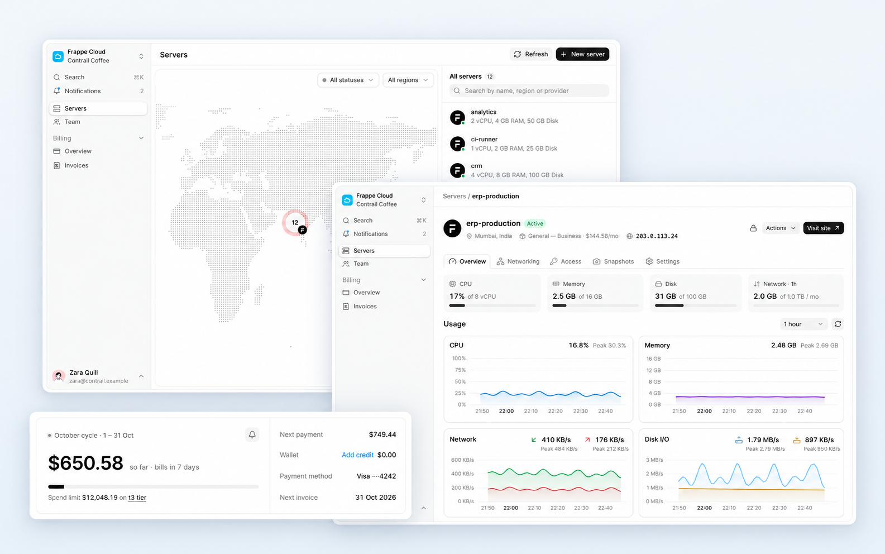

# Central

Central is the control plane for Frappe Cloud v2. It manages teams, permissions, servers, sites, managed services, and billing, and keeps an activity feed of the changes to each team and server. It includes a Frappe app and a Vue console.

<picture>
  <source media="(prefers-color-scheme: dark)" srcset=".github/screenshots/central-overview-dark.png">
  
</picture>

[Atlas](https://github.com/frappe/atlas) runs the regional infrastructure. [Pilot](https://github.com/frappe/pilot) manages benches and sites. [Cargo](https://github.com/frappe/cargo) builds server images.

## Local setup

Use Python 3.14, Frappe v16, Node.js 24, and Yarn. Install [Pilot](https://github.com/frappe/pilot#installation) and [create and initialize a development bench](https://github.com/frappe/pilot#basic-usage).

Run these commands from the bench directory:

```bash
pilot get-app https://github.com/frappe/central.git --branch develop
pilot new-site central.localhost
pilot install-app central.localhost central
pilot frappe --site central.localhost set-config developer_mode 1
pilot start
```

Open `http://central.localhost:<http_port>/dashboard` for the console or `/app` for Desk. Use the `http_port` from `bench.toml`.

On macOS, use `NO_PROXY='*' pilot start` if system proxy lookup stops background workers.

To provision servers, [connect a Region to Atlas and Cargo](central/infrastructure/doctype/region/SPEC.md).

## Console development

With Pilot running, open another terminal in `apps/central`:

```bash
yarn install
yarn dev
```

Use the development URL printed by Vite. To build assets, run `pilot build --apps central` from the bench directory.

Each push to `develop` publishes pre-built assets to the `assets-develop` GitHub release. Pilot downloads them instead of building the dashboard.

## Releases

Central uses [semantic versioning](https://semver.org) and two branches.

| Branch | Purpose | How changes arrive |
|---|---|---|
| `develop` | Staging. All work merges here. | Pull requests from feature branches |
| `main` | Stable releases | Only Mergify backports of merged `develop` pull requests |

To ship a change to `main`, add the `backport-main` label to its pull request on `develop`. Mergify opens a backport pull request and merges it when the checks pass. Mergify closes any other pull request to `main`. [`.mergify.yml`](.mergify.yml) holds these rules.

To release, run the [Weekly Release](.github/workflows/weekly-release.yml) workflow from `main`. It reads the commit subjects since the last `vX.Y.Z` tag, picks the next version, checks that CI passed on that commit, and creates the GitHub release with generated notes.

| Commit subject | Version change |
|---|---|
| `fix(scope): ...` | Patch |
| `feat(scope): ...` | Minor |
| `feat(scope)!: ...` or a `BREAKING CHANGE:` footer | Major, or minor before 1.0.0 |

In an emergency, a repository admin can merge a fix to `main` directly. Add the `emergency` label to the pull request and reopen it if Mergify closed it. Then merge the same fix to `develop`.

Report a vulnerability as described in [SECURITY.md](SECURITY.md).

## Documentation

- [User guide](https://frappe.github.io/central/): customer instructions for the console and Pilot.
- [Documentation source and setup](docs/README.md): develop the guide and capture screenshots and videos.
- [Specifications](spec/README.md): module behavior and integration contracts.
- [Contributor guide](CLAUDE.md): repository rules, checks, and isolated tests.
- [End-to-end tests](e2e/README.md): Playwright setup and commands.

## License

[AGPL-3.0](license.txt)
