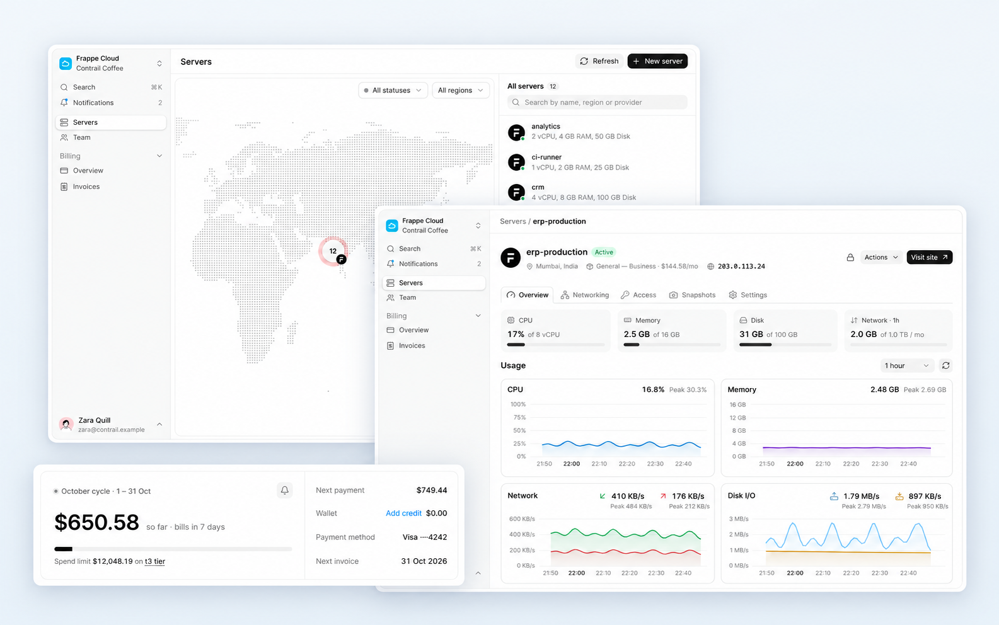

# Central

Central is the control plane for Frappe Cloud v2. It manages teams, permissions, servers, sites, managed services, and billing. It includes a Frappe app and a Vue console.

<picture>
  <source media="(prefers-color-scheme: dark)" srcset=".github/screenshots/central-overview-dark.png">
  
</picture>

[Atlas](https://github.com/frappe/atlas) runs the regional infrastructure. [Pilot](https://github.com/frappe/pilot) manages benches and sites. [Cargo](https://github.com/frappe/cargo) builds server images.

## Local setup

Use Python 3.14, Frappe v16, Node.js 24, and Yarn. Install [Pilot](https://github.com/frappe/pilot#installation) and [create and initialize a development bench](https://github.com/frappe/pilot#basic-usage).

Run these commands from the bench directory:

```bash
pilot get-app https://github.com/frappe/central.git --branch develop
pilot new-site central.localhost
pilot install-app central.localhost central
pilot frappe --site central.localhost set-config developer_mode 1
pilot start
```

Open `http://central.localhost:<http_port>/dashboard` for the console or `/app` for Desk. Use the `http_port` from `bench.toml`.

On macOS, use `NO_PROXY='*' pilot start` if system proxy lookup stops background workers.

To provision servers, [connect a Region to Atlas and Cargo](central/infrastructure/doctype/region/SPEC.md).

## Console development

With Pilot running, open another terminal in `apps/central`:

```bash
yarn install
yarn dev
```

Use the development URL printed by Vite. To build assets, run `pilot build --apps central` from the bench directory.

## Documentation

- [User guide](https://frappe.github.io/central/): customer instructions for the console and Pilot.
- [Documentation source and setup](docs/README.md): develop the guide and capture screenshots and videos.
- [Specifications](spec/README.md): module behavior and integration contracts.
- [Contributor guide](CLAUDE.md): repository rules, checks, and isolated tests.
- [End-to-end tests](e2e/README.md): Playwright setup and commands.

## License

[AGPL-3.0](license.txt)
