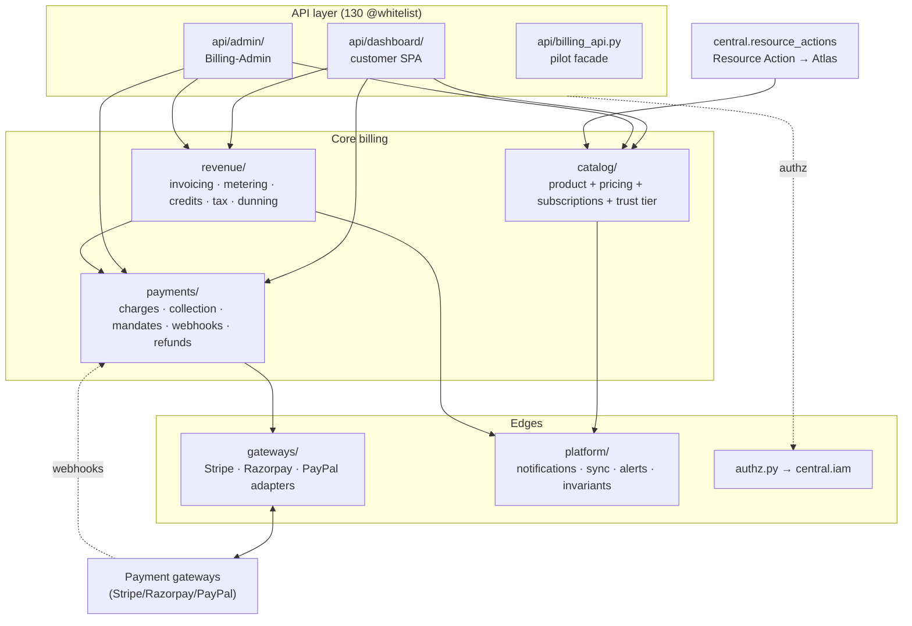
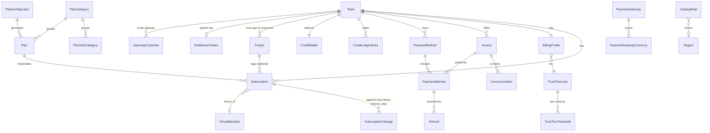
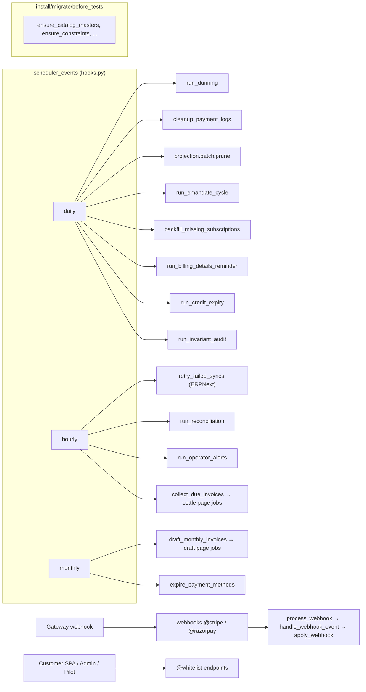
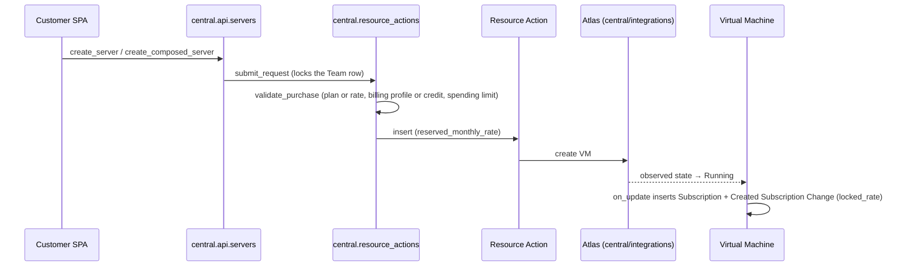
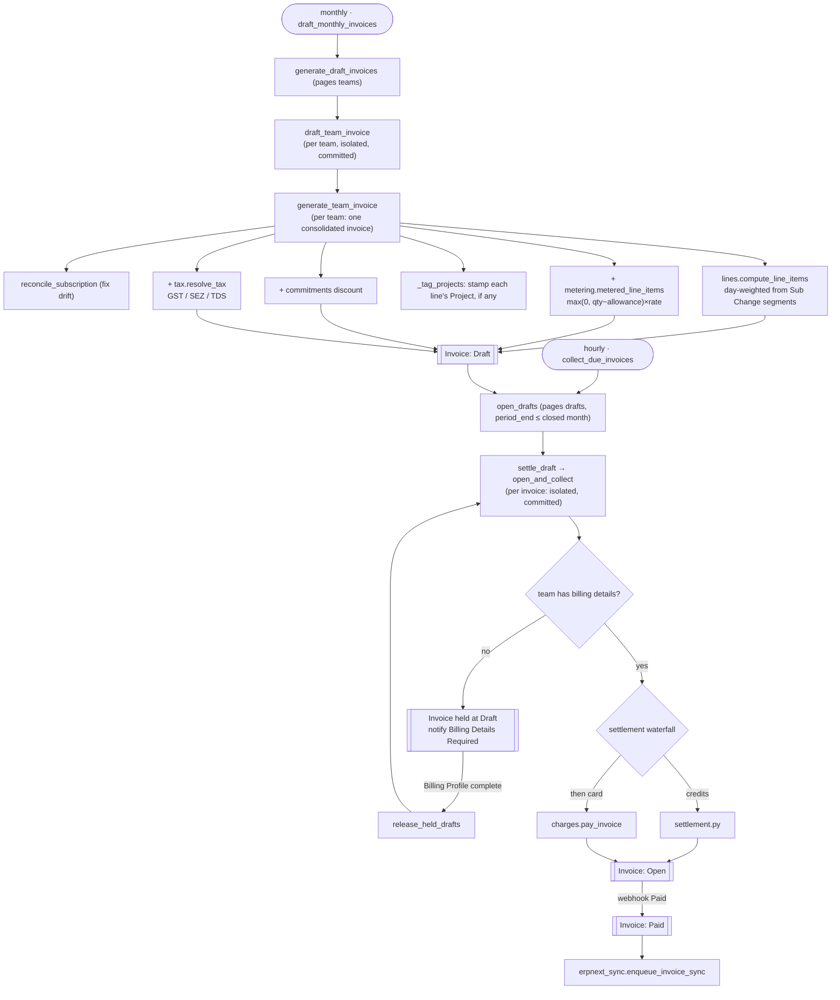
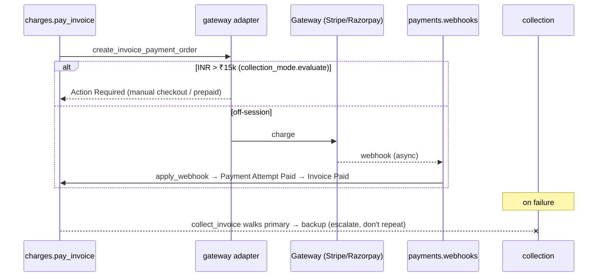
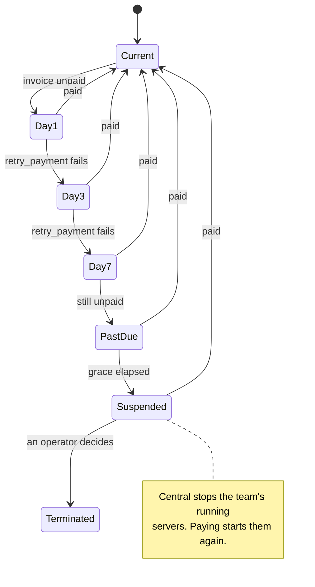
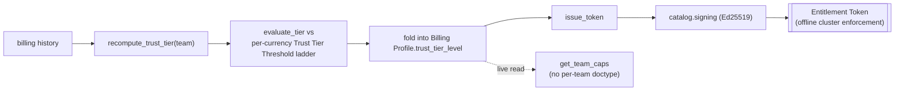

# Billing — Architecture & Debugging Map

> A glance-view of the `central.billing` module: what the sub-modules are, how they
> link, what triggers them, and where to look when something breaks. Start here, then
> jump to the named file. Paths are relative to `central/billing/`.
>
> 👉 To **stand up & demonstrate** billing from an empty site, see
> [`SETUP-AND-DEMO.md`](./SETUP-AND-DEMO.md). For the metered services API, see
> [`docs/metered-services-api.md`](./docs/metered-services-api.md).

Billing is a **postpaid, in-arrears** money system: Central provisions resources, records
the runtime it bills from, draws up an invoice in arrears, settles it (credits → card),
and chases the unpaid ones. There is **no Subscription Agent** (ADR 0006) — Central
provisions/records/enforces directly. Authorisation is Central's capability IAM
(ADR 0004), not billing-owned roles.

- Money is **float `Currency` in major units** (₹10.00 is stored `10.0`). Conversion to gateway minor
  units (Razorpay paise / Stripe cents) happens **only at the gateway boundary**. ADR 0003
  (integer minor units) is **DEPRECATED — it was never implemented**; don't design against it.

---

## 1. Layered sub-module map



Read top-to-bottom — each layer calls the one below it.

| Layer | Package | What it owns |
|---|---|---|
| **API, customer** | `api/dashboard/` | Team-scoped reads and actions for the customer SPA (`account`, `catalog`, `invoices`, `methods`, `outlook`, `projects`, `reports`, `services`, `spend`). |
| **API, admin** | `api/admin/` | Billing-Admin views: `catalog`, `revenue` (cost-explorer), `teams`, `gateways`, `projection`, `rerating`, `services`. |
| **API, pilot** | `api/billing_api.py` | X-Pilot-Token facade for a bench: payment methods, plans, metered services, credits, checkout. |
| **Catalog** | `catalog/` | The product & pricing authority: taxonomy masters, Plan Configurator, composed-config pricing, rate resolution, subscriptions (intent + state), trust tiers, entitlement signing. |
| **Revenue** | `revenue/` | Turning usage into money: `invoicing/` (draft→open→collect), `metering`, `credits`, `tax`, `commitments` discount, `dunning`, `pricelock`. |
| **Payments** | `payments/` | Moving the money: `charges`, `collection` (fallback), `collection_mode` (INR ₹15k gate), `mandates` (UPI), `emandate` (RBI), `payments` (cards), `webhooks`, `reconciliation`, `refunds`, `settlement`, `profile`. |
| **Ingester** | `ingester/` | Every sync with the accounting system: `connection` (HTTP client), `customer` (customer, address, contact), `erpnext_sync` (Sales Invoice push). |
| **Gateways** | `gateways/` | The adapter seam: `base.GatewayAdapter` + `stripe`/`razorpay`/`paypal` + `registry`. |
| **Platform** | `platform/` | `notifications` (sole sender), `sync` (record the runtime billed from), `alerts` (operator alerts, including `held_invoices`), `invariants` (money audit), `constraints` (DB constraints), `metrics`. |
| **Projection** | `projection/` | Cost projection and scenario engine for the admin `projection` API. |
| **Authz** | `authz.py` | Capability checks (delegates to `central.iam`). |

Cross-cutting reference data: `india_gst.py`, `regions.py`, `catalog/taxonomy_setup.py`.

---

## 2. Data model — the DocType graph



Grouped by concern. `→` = Link field; **[C]** = child table; **[1]** = single.

**Catalog / product**
```
Resource Type
Plan Category ──allowed_resource_types─→ [C]Plan Category Resource Type ─→ Resource Type
Plan Sub-Category ──category─→ Plan Category
Plan ──category─→ Plan Category, ──sub_category─→ Plan Sub-Category, ──includes─→ [C]Plan Includes ─→ Resource Type
Catalog Rate ──priced_doctype─→ DocType, ──priced_for─(dynamic)→, ──cluster─→ Region, ──currency
Plan Configurator ─→ Category, Sub-Category, [C]base_rates, [C]rungs(─→Plan), [C]simple_plans(─→Plan)
```

**Subscription / state**
```
Subscription ──team, ──project─→ Project, ──plan, ──sub_category, ──includes─→ [C]Plan Includes,
             ──default_payment_method, ──gateway, ──server_id─→ Virtual Machine,
             ──vm_snapshot─→ VM Snapshot, ──public_ip_server─→ Virtual Machine (its public IPv4),
             cluster (read-only, from server_id.region), service_subject
Subscription Change ──subscription, ──team, ──currency      (append-only history + locked_rate)
Project ──team, ──title, ──enabled, ──spending_limit          (cost-tag + run-rate cap; see §2.1)
```

**Invoice / money**
```
Invoice ──team, ──items─→ [C]Invoice Line Item
Invoice Line Item ──project, ──project_title                  (snapshot tag, stamped at generation; see §2.1)
Payment Attempt ──invoice, ──team, ──gateway, ──payment_method, gateway_order_id   (on-session and hosted payments)
Top-up Order ──team, ──gateway, ──ledger_entry, gateway_order_id    (a wallet top-up, stored before the payer acts)
Refund ──payment_attempt, ──invoice, ──team
Credit Ledger Entry ──team, ──currency                        (append-only)
Credit Wallet ──team                           (lock anchor / cached balance — one per (team,currency))
Commitment ──team, ──currency              (spend floor)
Usage Rollup ──team                            (metered aggregation)
```

**Payment plumbing**
```
Billing Profile ──team, ──currency, ──country, ──trust_tier_level   (currency = source of truth, locks after activity)
Payment Method ──team, ──gateway
Payment Gateway ──currencies─→ [C]Payment Gateway Currency
Gateway Customer ──team, ──gateway             ((team,gateway) → customer_id)
Tax Profile ──team
```

**Trust tier / entitlement**
```
Trust Tier Level ──thresholds─→ [C]Trust Tier Threshold ──currency   (per-currency thresholds)
Entitlement Token ──team       (Ed25519-signed cap)
```

**Plumbing / logs**
```
Webhook Event ──gateway        | Billing Notification Log ──team
```

### 2.1 Project — cost tagging + a spending limit, one bill

A **Project** is a user-defined tag a team applies to its own Subscriptions — e.g. to
see what one internal team or customer costs inside an otherwise-shared bill. It is
**purely a cost-attribution + guardrail concept**: the team is always billed on **one
consolidated invoice per period**, exactly as if Projects did not exist. Tagging a
resource into a Project never changes who is billed, when, or on how many invoices.

**Invoice breakdown.** Every billable line (fixed or metered) is stamped with the
Project its resource is tagged into, if any — `Invoice Line Item.project` /
`project_title` — a snapshot taken at generation time (`revenue/invoicing/generate.py`'s
`_tag_projects`, called from `_rate`, the one function every line passes through for
both a real Invoice and a live forecast/cycle-tray read). An untagged resource, or one
tagged into a disabled Project, simply carries no project on its lines — it still bills
normally, just without a label. `Invoice.period_key` is plain
`team|period_start|period_end` (ADR 0018, invariant I6) — a team is billed at most once
per period, full stop; Projects add no dimension to that grain.

**Spending limit.** A Project optionally carries `spending_limit` — a cap on its
**committed monthly run-rate** (the summed `locked_rate` of every subscription tagged
into it, `catalog.subscriptions.project_run_rate`). `Subscription.validate_project`
calls `catalog.subscriptions.enforce_project_headroom` whenever a subscription is newly
tagged into a Project (on insert, or when its `project` field changes), and refuses the
tag if the addition would push the Project's committed run-rate past its limit. This
blocks **new tagging only** — an already-tagged, already-running subscription is never
throttled or stopped by a limit added or lowered later; the same "blocks new, never
touches existing" shape as trust-tier headroom (`enforce_headroom`), scoped to one
Project instead of the whole team. 0 or unset = unlimited.

**No delete** — a Project with billing history is load-bearing (past Invoice Line Items
carry its name/title as a snapshot); disabling (`Project.enabled = 0`) is the retirement
path. `Subscription.validate_project` refuses a *new* tag onto a disabled Project for
the same reason it refuses a foreign one: silently tagging something that means nothing
would be worse than refusing it outright. Disabling does not untag existing
subscriptions, and re-enabling resumes tracking with no retagging needed.

**Deliberately out of scope**: Projects have no relationship to credits or payment
methods at all — there is one `Credit Wallet` per (team, currency) and one Payment
Method fallback order per team, neither scoped by Project in any way. A
team-level Commitment (volume discount) and cost projection both operate on the team's
whole set of resources; a Project is never a unit either reasons about, only a label
lines carry.

---

## 3. Trigger surface — what fires what



### Scheduled (`central/hooks.py` → `scheduler_events`)
Dunning, reconciliation, the e-mandate cycle, credit expiry, card expiry, accounting-sync retries and the subscription backfill run each row through `platform.jobs.each_isolated`: a savepoint and a commit per row, and a row that fails is logged to the Error Log and skipped, so it does not stop the rows after it.

| Cadence | Entry point | Purpose |
|---|---|---|
| daily | `revenue.dunning.run_dunning` | Day 1/3/7 retries → past_due → suspend (stops servers) → termination due (operator) |
| daily | `payments.charges.cleanup_payment_logs` | prune Payment Attempt / Webhook Event |
| daily | `projection.batch.prune` | prune old projection batches |
| daily | `payments.emandate.run_emandate_cycle` | INR ≤₹15k pre-debit notice → debit after 24h |
| daily | `catalog.subscriptions.backfill_missing_subscriptions` | Subscription for any Running Virtual Machine missing one |
| daily | `payments.settlement.run_billing_details_reminder` | ask credit-funded teams for the billing details their invoice will need |
| daily | `revenue.credits.run_credit_expiry` | write off expired promotional credit |
| daily | `platform.invariants.run_invariant_audit` | audit the cross-table money invariants |
| hourly | `payments.webhooks.retry_failed_webhooks` | apply again failed and lost webhook events |
| hourly | `payments.reconciliation.run_reconciliation` | charged-but-never-webhooked gateway scan |
| hourly | `platform.alerts.run_operator_alerts` | alert operators (invariants, readiness, failed webhooks, stale attempts, unsettled captures, held invoices, failed refunds, failed accounting syncs) |
| monthly | `revenue.invoicing.draft_monthly_invoices` | waive internal teams' unpaid invoices, then draft the just-closed month as page jobs on the `billing` queue |
| hourly | `revenue.invoicing.collect_due_invoices` | open and collect every Draft whose month has closed, as page jobs; record progress on the Billing Run |
| hourly | `ingester.erpnext_sync.retry_failed_syncs` | retry Sales Invoice push (backoff window elapsed) |
| monthly | `payments.payments.expire_payment_methods` | flip cards past their printed month |

**The scheduled run is paged.** On the 1st, `draft_monthly_invoices` drafts the closed month as page jobs. Every hour, `collect_due_invoices` collects whatever has drafted and updates the **Billing Run** row for the month (start, counts, failures, completion). A lost worker stops one page only; the next hourly sweep picks up the rest. `run_monthly_billing` does both phases inline in one job; use it only for a small site or a test.

The readiness check B5 flags a month with billing but no Billing Run, and drafts that waited more than 3 hours to be collected. It feeds the hourly operator alerts.

**The fan-out is two orchestrators, and neither of them does the work.** Each keyset-pages its subjects and enqueues a **page job** per slice: `draft_team_page(after, until)` / `settle_draft_page(cutoff, after, until)`, deduplicated on the slice's upper bound. A page job re-derives its slice from the bounds and works it in order. It commits after **each team / each invoice**. The page is the unit of *scheduling* and the team is still the unit of *work*, so a job killed at team 300 of 500 keeps the 299 it finished.

`collect_due_invoices` opens every Draft whose month has closed (`period_end <= the just-closed month`). A settled draft drops out of the scan, so you can run it again until nothing is owed. A late draft, or one a settle page left behind, is collected on the next run.

Not a job per team, deliberately. At a million teams that is a million redis
round-trips in one scheduler tick — a cron job runs on a **300-second** timeout
(`get_queue_name()` gives cron jobs the `default` queue), so it would be killed
around 150k teams having never handed out the rest, and a million queued jobs is
gigabytes of redis. Two thousand page jobs cost seconds and megabytes.

**The billing queue is the throughput knob and the rate-limit cap, at once.** A fanned-out run uses its own queue, not `long`, configured in `common_site_config.json`:

```json
"workers": {"billing": {"timeout": 3000, "background_workers": 8}}
```

Because a page job works its invoices *sequentially*, the number of billing workers
is exactly the number of gateway charges in flight. That is the only thing standing
between a million-invoice month and a wall of 429s — there is no token bucket yet, so
**this number is the rate limit**. Set it against the gateway's documented ceiling
(Stripe ≈ 100 req/s; a charge is ~2s, so W workers ≈ W/2 req/s). Raising it is how
you go faster; there is no other dial. `billing_queue()` falls back to `long` with a
warning if the bench hasn't declared the queue — enqueuing to a queue nobody consumes
would mean the month silently never gets billed.

A unit that fails is contained: logged to the billing log file *and* as a
`Billing Run Failure` Error Log row, rolled back to its own savepoint, and re-attempted
by the next tick since both phases are idempotent. If the savepoint itself is gone —
the database restarted, the connection dropped — the failure is **re-raised** instead:
that is the machinery breaking, not a bad team, and containing it would turn one
outage into a silent run in which nobody was billed.

The run bills on the 1st, not the 28th. A calendar month billed in arrears is not closed until it ends, so drafting on the 28th would bill days that had not happened.

`billing_run_status()` reports what the current period's run has achieved (drafted / pending / collected / failures). It derives this from the tables, not from a counter. Read it before you run a period again.

**Worker math.** One collected invoice ≈ 2s (rating is ~100ms; the rest is the gateway
round-trip). Sequentially, a million invoices is ≈ 23 days. Over W billing workers it is
1M × 2s / W: **8 workers ≈ 69h, 32 ≈ 17h, 64 ≈ 9h** — and 64 workers is ~32 charges/s,
still inside a 100 req/s gateway ceiling. Drafting is cheaper (~0.3s/team): 1M teams
over 32 workers ≈ 2.6h. Size the pool from the
team count, never from the invoice amount.

**What the run actually contends on.** The tables a draft reads — Subscription,
Subscription Change, Payment Method, Catalog Rate, Usage Rollup — are read with plain
consistent reads, which under InnoDB MVCC take **no locks at all**, so no number of
workers can make them block each other. Credit Wallet *is* locked `FOR UPDATE`, but the
key is (team, currency): a team only ever contends with its own concurrent top-up.

Provisioning is the one path that does lock those tables: deciding whether credit covers
a new server is a read the caller then acts on. A create request holds the Team row, reads
its pending Resource Action reservations `FOR UPDATE`, then takes the wallet anchor and
reads Subscription + Subscription Change `FOR UPDATE` behind it. Otherwise two creates
clear the same balance. Every read is an index range scoped to the one team, and the order
is always Team, pending requests, wallet. The run is unaffected: a plain consistent read
never waits on them.

There is exactly one **global** lock in the run, and it is not a data table. Every
Invoice insert calls `make_autoname("INV-YYYY-MM-.#####")`, which takes the `tabSeries`
row `FOR UPDATE` and holds it **until the transaction commits** — so every worker in
the run queues behind one row. Measured on a dev bench: ~6ms held per invoice, i.e. a
ceiling of **~169 invoices/sec however many workers you add**, or ~1.6h for a million.
That sits *above* the worker-bound rate until roughly 50 billing workers (at ~0.3s of
rating per team, W workers deliver W×3.3/sec), so it is a ceiling to know about, not
one to design around yet. If you ever need past it, shard the series — `INV-YYYY-MM-A-`,
`-B-`, … per page — which GST permits as long as each series is itself consecutive.

Two things keep that lock short, and both are load-bearing:

- **One team = one transaction = one commit**, inline and fanned out alike. A page job
  that committed once at the end would hold the series row for 500 teams — minutes —
  and every other worker would hit `innodb_lock_wait_timeout` (50s by default). The
  commit inside the page loop is what makes the critical section milliseconds.
- **Contention is retried, not contained.** A lock-wait timeout (1205) or deadlock
  (1213) means the team lost a race, not that its data is bad. `draft_team_invoice`
  retries it with jittered backoff (`CONTENTION_RETRIES`), because the draft tick comes
  round once a *month* — a contained loser would go unbilled until someone noticed.
  Only after the budget is exhausted is it recorded as a `Billing Run Failure`.

**A late run never costs the customer grace.** `due_date` and `dunning_starts_on` are
both set from the day the invoice is actually *opened*, so a run three days behind
bills three days later rather than three days overdue. Beyond that, any collection
failure on our side — a 429, a dead worker, a contained run error — calls
`dunning.defer_dunning`, which pushes `dunning_starts_on` (never `due_date`, which is
an accounting fact AR aging depends on) forward to today + the standard window. It is
monotonic and self-limiting: a successful ask stops pushing, so a broken gateway defers
*escalation*, not collection.

### Operator alerts

`platform.alerts.notify_operators(title, alerts)` sends every billing alert for operators. No other billing code mails operators. Customer notifications use `platform.notifications` and do not change with these settings.

Configure it in **Billing Settings → Operator Alerts**:

| Field | Purpose |
|---|---|
| Alert Channel | `Raven` (default), `Email`, or `Raven and Email`. |
| Alert Email Addresses | One address per line. Required when the channel includes Email. Central never mails the System Manager role. |
| Raven Site URL, Raven Channel ID | The Raven site and the channel that gets the alerts. |
| Bot API Key, Bot API Secret | The API key of a bot user that is a member of the channel. The alert is posted as this user through `raven.api.raven_message.send_message`. |

When a Raven post fails, or Raven is not configured, the alert goes to the email addresses once and the failure is written to the Error Log. Use **Send Test Alert** on the form to check the saved settings. The hourly digest keeps one Error Log row for each digest it sends, and it does not send the same digest again for `REPEAT_AFTER_HOURS`.

### Lifecycle / install hooks
- `after_install` / `after_migrate` / `before_tests` → `catalog.taxonomy_setup.ensure_catalog_masters` (idempotent seed of catalog masters, ADR 0007), `settings.ensure_snapshot_settings`, `platform.constraints.ensure_constraints`, `gateways.setup.ensure_gateway_records`, `navigation.ensure_workspace_sidebars`. `after_install` and `before_tests` also run `settings.ensure_welcome_credit_amounts`.
- `doc_events`: `Team.on_update` → `payments.provisioning.on_team_update`. Server Subscriptions are not in `doc_events`: the Virtual Machine controller's `on_update` creates the Subscription when the server reaches Running and closes it when the server is Terminated.
- `override_doctype_dashboards["Currency"]` → `api.dashboard_overrides.currency_dashboard`.

### Inbound webhooks (`payments/webhooks.py`)
`@stripe` / `@razorpay` / `@paypal` (whitelisted, signature-first; PayPal is verified through its verify-webhook-signature API) → `process_webhook` → adapter `verify_webhook_signature`/`parse_webhook_event` → `handle_webhook_event`. Raw payload persisted to **Webhook Event** for dedupe/replay.

`handle_webhook_event` sends each event to one handler. The handler links the Webhook Event to the Payment Attempt or Payment Method it is about, so the record's Connections show its event history.

**When a handler fails.** Its writes are rolled back to a savepoint, the event becomes Failed with the traceback in Error and its Tries count goes up. `retry_failed_webhooks` runs hourly and applies again every Failed event under `MAX_TRIES`, and every Received event older than `STALE_RECEIVED_MINUTES` (its job was lost). `platform.alerts.failed_webhooks` pages an operator while an event stays Failed. A Razorpay event is deduped on an id built from the signed body (event, `created_at` and entity ids), because the `X-Razorpay-Event-Id` header is outside the signature. A gateway cannot be enabled without a webhook secret, and a missing secret or signature verifies nothing.

| Events | Handler | Effect |
|---|---|---|
| `payment_intent.*`, `payment.*`, `PAYMENT.CAPTURE.*` | `charges.apply_webhook` | Authorised, Captured or Failed. `payment_intent.canceled` fails the attempt with Stripe's cancellation reason. A PayPal PENDING capture keeps the attempt open (`gateway_hold_until`) instead of failing it. |
| `charge.dispute.*`, `payment.dispute.*` | `disputes.apply_dispute` | Note on the invoice; a lost dispute cancels the invoice without a second refund. A lost dispute on an invoice that is no longer Paid is flagged for an operator. |
| `charge.refund.updated`, `refund.failed`, `refund.processed` | `corrections.apply_refund_event` | Finishes a Pending refund as Completed or Failed. Reconciliation asks the gateway about any Pending refund the webhook missed. |
| `mandate.updated` | `mandates.apply_mandate_event` | A revoked mandate cancels its Payment Method. |
| `payment_method.detached` | `payments.apply_payment_method_event` | The card is cancelled and leaves the charge order. |
| `setup_intent.setup_failed` | `payments.apply_payment_method_event` | The failure code, decline code and message on the card, its failed attempt count, and a `Payment Method Setup Failed` Billing Event. The card stays Pending Validation, because the customer can retry on the same SetupIntent. Central finds the card by the SetupIntent: an in-app setup keeps it as the Setup Reference, and a hosted setup keeps it as the Setup Intent ID. |
| `charge.refunded` | none | Stored only. A refund made in the gateway dashboard leaves no Refund record. |

**Subscribed events.** Each adapter's `webhook_events` lists the events Central subscribes to. `test_payment_gateway.TestWebhookEventList` fails when a handled event is not in that list.

**Webhook endpoint.** On the Payment Gateway form:

- **Register Webhook** (or **Re-register Webhook** when an endpoint exists) checks the keys and creates a new endpoint and a new signing secret. The old endpoint is not deleted at the gateway. When no new endpoint is registered, for example on a local site, the current endpoint and secret are kept.
- **Webhook Events → Pull** reads the endpoint from the gateway and fills the Webhook Events table. Each event is OK, Missing (Central needs it, the gateway does not send it) or Not Used.
- **Webhook Events → Update** sets the endpoint's events to the adapter's list. The signing secret does not change.

When you save new keys, Central reads the stored endpoint with them. If the keys can see it (same account), Central adds any missing events. If they cannot (another account, or Stripe test keys changed to live keys), Central registers a new endpoint. Central never deletes an endpoint at the gateway, because another site can use the same account. A PayPal gateway that settles through Razorpay has no webhook of its own. PayPal calls go to the sandbox host unless site config `paypal_api_base` is `https://api-m.paypal.com`; no other host is accepted, because the client secret is sent there.

### API entry points (`@frappe.whitelist`): see §5 per package.

---

## 4. Key end-to-end flows

### A. Create a server (customer creates a server)

```
central.api.servers.create_server | create_composed_server
  → central.resource_actions.submit_request         (locks the Team row)
      → validate_purchase
          → plan from get_server_plans, or composition.validate_composition + pricing.resolve_config_rate
          → resource_actions.require_payment_method_or_credit(team, rate + reserved_rate(team))
          → spending-limit check against the catalog's available headroom
      → Resource Action (carries reserved_monthly_rate)
  → central/integrations → Atlas creates the VM
  → Virtual Machine.on_update (status Running)
      → inserts the Subscription and its Created Subscription Change (carries locked_rate)
```
`api/dashboard/catalog.provision_composed_config` still exists, but it only records a subscription. It does not create a server.

Resize: `central.api.servers.resize_server` → `catalog.subscriptions.begin_resize` (validates, persists a Resource Action) → `central.integrations.resource_actions` → `apply_resize_billing` → `resize_composed_subscription` → new Subscription Change (re-prices).

### B. Bill a period (draft → open → collect)

```
[monthly]  revenue.invoicing.draft_monthly_invoices   (settle_internal_teams, then page jobs)
  → generate_draft_invoices (pages teams)
  → draft_team_invoice (one team = one transaction = one commit)
    → generate_team_invoice (per team, aggregates every cluster it runs in)
      → reconcile_subscription (correct drift if stale)
      → lines.compute_line_items  (day-weighted, from Subscription Change rate-snapshot segments)
      → + metering.metered_line_items   (max(0, qty−allowance) × rate)
      → _rate → _tag_projects stamps each line's Project (if its resource is tagged
        into one that's enabled, §2.1), then + commitments discount, + tax.resolve_tax
        (GST additive / SEZ zero / TDS withhold)
  → Invoice (Draft), one per team, same period, `period_key` keyed on (team, period)

[hourly]   revenue.invoicing.collect_due_invoices   (snapshot the Billing Run, then page jobs)
  → open_drafts (every Draft with period_end ≤ the closed month)
  → settle_draft → open_and_collect (per invoice)
      → billing-details hold: a Billable draft stays Draft if the team has no billing
        details (lifecycle._hold_for_billing_details, notifies "Billing Details Required")
      → settlement waterfall: credits (settlement.py) → card (charges.pay_invoice)
      → Invoice Draft → Open → (on webhook) Paid
      → on Paid: erpnext_sync.enqueue_invoice_sync
```
A held draft is released when the profile is complete. `Billing Profile.on_update` calls `release_held_invoices`, which enqueues `run.release_held_drafts` to settle the held drafts. When a draft waits longer than `Billing Settings.billing_details_grace_days`, the team stops being credit-funded for new spend (`settlement.details_overdue`), and `platform.alerts.held_invoices` pages operators.

Both ticks use `draft_team_page` and `settle_draft_page` page jobs (see §3).

### C. Collect / settle a charge

```
charges.pay_invoice → create_invoice_payment_order (via gateway adapter)
  → gateway charges off-session OR returns Action Required (INR > ₹15k, collection_mode.evaluate)
  → webhook arrives → apply_webhook → Payment Attempt Paid → Invoice Paid
  → failure → collection.collect_invoice walks primary → backup methods (escalate, don't repeat)
```
**How a payment is matched to what Central asked for.** Before the payer acts, Central stores a row for the payment: a Payment Attempt for an invoice, a Top-up Order for a wallet top-up. Its name is the receipt sent to the gateway, and the gateway's order id (a Razorpay order, a Stripe PaymentIntent or Checkout Session, a PayPal order, a Razorpay Payment Link) is stored on it. The webhook, every confirm route, the pilot poll and reconciliation read the payment back as a `VerifiedPayment` (a server-side read or a signed webhook body) and find the row by the gateway's ids, or by `metadata.receipt` on Stripe, which only the secret key can set. Razorpay payment notes are never read, because Checkout lets the payer set them. The payment must be captured, in the row's currency, for at least its amount:

| Case | Result |
|---|---|
| No stored row | Nothing is settled or credited. The event is Ignored. |
| A declined payment on a Top-up Order | The order keeps the failure code, decline code, message and failed attempt count of the last decline. Each decline also adds a `Top-up Order Declined` Billing Event with its failure code. A repeated webhook adds no second event. The order stays Created, because the payer can try again. |
| A declined payment on a mandate authorisation order | The Pending Validation method keeps the failure, and a `Payment Method Setup Failed` Billing Event is added. |
| Short or another currency | Nothing is settled. The invoice gets a comment and an Error Log entry. |
| More than is due | The invoice is Paid and the surplus goes to the wallet. |
| The invoice is no longer Open or Overdue | The payment goes to the wallet, once per payment id, and an operator is told. |

Reconciliation asks the gateway about the stored order of an unanswered on-session attempt, and fails it only after `CHECKOUT_OPEN_HOURS`. It credits a Top-up Order that was paid but never confirmed, and expires one nobody paid after `TOP_UP_EXPIRES_HOURS`.

Method resolution is team-wide, not scoped by anything — `collection.ordered_methods`
returns the team's active methods, priority order. `charges._resolve_method` (manual
"pay now") and `collection.next_method_for`/`collect_invoice` (the real auto-charge
path) both read off this same list, but `_resolve_method` deliberately skips
`next_method_for`'s "already failed" exclusion — it resolves a *default*, not a fallback
rotation, so a manual retry must land on the same card twice, not silently rotate.

### D. Dunning (unpaid invoice)

```
daily run_dunning → process_invoice_dunning(invoice)
  → retry_payment on Day 1/3/7 → account_standing past_due → suspend → termination due
  → suspend: subscriptions.suspend_for_nonpayment moves every subscription of the team to
    Suspended, stops its running servers and flags them stopped_for_nonpayment
  → paid: Invoice.on_update → subscriptions.restore_after_payment (standing Current, start
    what dunning stopped) once the team has no other overdue invoice
  → termination due: platform.alerts.termination_due pages an operator; nothing is deleted
  → while behind on payment a team cannot create, resize up or subscribe (PAYMENT_OVERDUE)
```
Billing stops and starts a server as the system (`resource_actions.submit_billing_command`), because a payment can arrive by webhook as Guest. `submit_command` refuses a customer `start` while the server's subscription is Suspended.

### E. Metering
```
platform.sync.record_meter_rollups  (Central writes the runtime it bills)
  → revenue.metering.ingest_rollup → Usage Rollup
  → metering.metered_line_items at invoice time → line items
```

### F. Credits waterfall & wallet gating
```
revenue.credits.purchase → Credit Ledger Entry (append-only) + Credit Wallet (FOR UPDATE lock anchor)
settlement.effective_spend_cap = min(trust-tier cap, wallet)   (credits-only mode)
settlement.can_accept_spend gates money movement; 80% forecast warning
```
`open_and_collect`'s credits leg draws `credits.get_balance(team, currency)` — the
team's one wallet, no scoping of any kind (Projects have no relationship to credits;
see §2.1).

### G. Trust tier / entitlement

```
catalog.entitlements.recompute_trust_tier(team)
  → evaluate_tier against per-currency Trust Tier Threshold ladder
  → folds into Billing Profile.trust_tier_level
  → issue_token → catalog.signing (Ed25519) → Entitlement Token (offline cluster enforcement)
get_team_caps resolves caps live (no per-team Trust Tier doctype — dropped)
```

---

## 5. API surface (by package)

**`api/dashboard/`** (customer, team-scoped)
- `account.py`: whoami, get/save_billing_profile, get_billing_geo, get/save_billing_settings, get_collection_status, set_collection_mode, get_team_overview, get_trust_tier.
- `catalog.py`: get_eligible_plans and provision/get_composed_config.
- `invoices.py`: get_forecast, list/pause/resume_subscription, set_subscription_project, list/get_invoice, list_payment_attempts, get_credit_balance, credit_ledger, pay_invoice, get_fallback_offer, pay_invoice_checkout/confirm_invoice_checkout, get_topup_options, create_topup_order/confirm_topup.
- `methods.py`: list/options, card setup + confirm, fallback-order setup/confirm/reorder, set_default, remove.
- `outlook.py`: get_next_payment, get_payment_schedule.
- `projects.py`: list/create/rename_project, set_project_enabled, set_project_spending_limit.
- `reports.py`: get_spend_history, get_statement, get_tax_summary, list_refunds, export_csv.
- `services.py`: get_metered_services, subscribe_metered_service.
- `spend.py`: get_cycle_costs.

**`api/admin/`** (Billing-Admin)
- `catalog.py`: get_catalog, create_configured_plan, update_plan_rate, get_cluster/plan_consumption, get_conversion, get_trial_detail/get_trial_costs_detail.
- `revenue.py`: summary, revenue_trend, cluster/team_breakdown, payment_analytics, overdue_aging, free_trial_costs, list_all_invoices.
- `teams.py`: team_billing, adjust_team_credits, retention, metrics, list_teams, payment_failures, delinquent_teams.
- `gateways.py`: get_gateways, effective_routing, set_default_gateway.
- `projection.py`: team and cohort projections, scenarios, scenario library, drift and batch comparison.
- `rerating.py`: preview_rerating, apply_rerating, correct_rollup_terms.
- `services.py`: get_team_services, subscribe_team_service.

**Other whitelisted**: `catalog/plans.py` (create_configured_plan, get_plan_pricing), `revenue/credits.py` (purchase, adjust_credits, get_balance), `ingester/erpnext_sync.py` (sync_invoice), `payments/charges.py` (pay_invoice), `payments/payments.py` (initiate/confirm payment method, set_default, reorder, delete), `payments/webhooks.py` (stripe, razorpay), `india_gst.py`, and the `payment_gateway` / `plan_configurator` doctype controllers.

> **Gotcha:** dashboard *mutations* must declare `methods=["POST"]` — frappe-ui `useCall`
> defaults to GET, and Frappe rolls back writes on GET (the toast lies, nothing persists).

---

## 6. Debugging cheat-sheet — symptom → where to look

| Symptom | Start at |
|---|---|
| Invoice never generated | `billing_run_status()`: is the team in `pending_draft`? Then Error Log `Billing Run Failure` for that team, the `billing` queue, and `lines.compute_line_items` for empty segments |
| Half the teams billed, half not | a partial run: read `billing_run_status()`, fix the cause, run `draft_monthly_invoices` again; the hourly `collect_due_invoices` collects the rest. Both phases are idempotent and resume |
| Billing run never starts / jobs pile up | is there a worker on the `billing` queue? (`common_site_config.workers.billing` + `bench worker --queue billing`); the billing log warns and falls back to `long` if the queue is undeclared |
| Two creates both cleared the same credit, or a create waits on a lock | `settlement.wallet_funds` takes the team's Credit Wallet anchor `FOR UPDATE` and reads the run rate through `subscriptions.locked_team_run_rate`; the lock is held to the end of the request, so one team's concurrent creates queue. Check nothing on the create path takes Subscription before Credit Wallet |
| Lock wait timeouts during the run | check the per-unit `frappe.db.commit()` in `draft_team_page`/`settle_draft_page` is still there — without it the `tabSeries` lock is held for a whole page; then check nothing new writes a shared row inside the unit |
| Run is far too slow | `background_workers` on the billing queue is the only throughput dial — but it is also the gateway concurrency cap; check for 429s (`Billing Run Failure` Error Logs, `dunning_starts_on` deferrals) before raising it |
| Customer dunned during a backlog | should be impossible: `dunning_starts_on` is pushed by `dunning.defer_dunning` on every failure of ours. If it happened, find the collection path that failed without calling it |
| Invoice wrong amount | `lines.compute_line_items` (day-weighting), `metering.metered_line_items`, `commitments` discount, `tax.resolve_tax`; verify Subscription Change `locked_rate` segments |
| Charge stuck "Open"/unpaid | `payments/webhooks.py` (signature failed? Webhook Event row?), `charges.apply_webhook`, `collection.collect_invoice` fallback chain |
| Webhook ignored | `webhooks.process_webhook` signature check; gateway `verify_webhook_signature`; dedupe against existing Webhook Event |
| Money movement blocked | `settlement.can_accept_spend` / `effective_spend_cap`; Billing Profile complete? Credits can fund a create without a profile; otherwise a payment method is needed (`resource_actions.require_payment_method_or_credit`); currency set? `collection_mode.evaluate` (INR ₹15k gate) |
| Wrong price | rate resolution: `catalog/pricing.py` (`resolve_rate`/`resolve_config_rate`), `rate_card`, Plan Configurator is the single pricing authority (ADR 0011) |
| Tier/cap wrong | `catalog.entitlements` (`get_team_caps`, `evaluate_tier`, per-currency Trust Tier Threshold) |
| Provisioning failed | `central.resource_actions.submit_request` / `validate_purchase` (`require_payment_method_or_credit`, `reserved_rate`, spending limit), the Resource Action record, `composition.validate_composition` bounds |
| Invoice stuck in Draft | `lifecycle._hold_for_billing_details` / `held_drafts`: is the Billing Profile incomplete? `platform.alerts.held_invoices` lists drafts held past `billing_details_grace_days` |
| Card declined repeatedly | `collection` (escalate don't repeat), `mandates.effective_cap`, dunning Day 1/3/7 |
| A line's Project breakdown is missing/wrong | `generate._tag_projects`/`_resource_project_map` — is the resource's Subscription tagged, is its Project `enabled`? A disabled Project's lines carry no tag by design (§2.1); check `Invoice Line Item.project`/`project_title` on a real invoice, or the same fields on a forecast line |
| Tagging a subscription into a Project is refused | `Subscription.validate_project` — same-team? Project `enabled`? `catalog.subscriptions.enforce_project_headroom` — would the tag push the Project's committed run-rate (`project_run_rate`) past its `spending_limit`? (blocks new tagging only, §2.1) |
| ERPNext out of sync | `erpnext_sync` (async, never rolls back the invoice; check retry backoff) |
| Catalog masters missing | `taxonomy_setup.ensure_catalog_masters` (runs on install/migrate/before_tests) |
| Money rounding off | money is float `Currency` (major units); check the rate field's decimal **precision** holds sub-cent rates, and that minor-unit conversion happens *only* in `gateways/` |

---

## 7. Tests & migrations

- **Tests** live in `tests/` (one `test_<area>.py` per concern) — the fastest way to learn a
  flow is to read its test. `tests/utils.py` (`ensure_team`) + `tests/e2e.py`.
- **Migrations** live flat in `central/patches/v0_0/` and run in the order of `central/patches.txt`. Check here when a field "moved" or "disappeared".
- **End-to-end Playwright** suite lives in the app root `e2e/billing/` (no-mock, real Stripe test).
