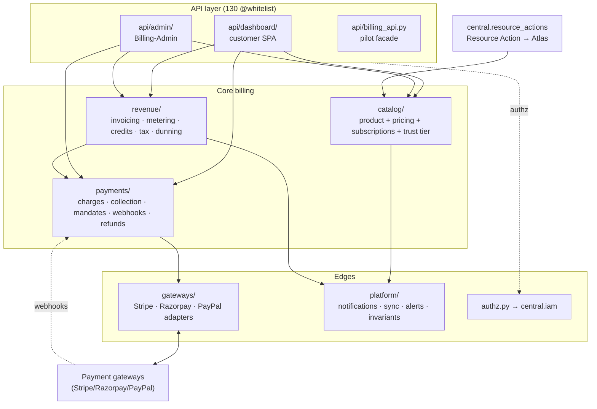
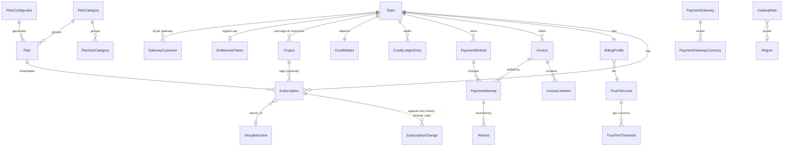
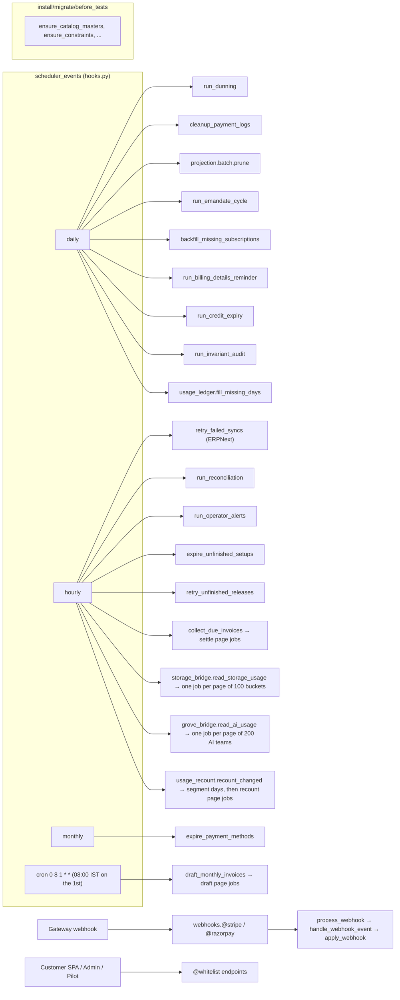
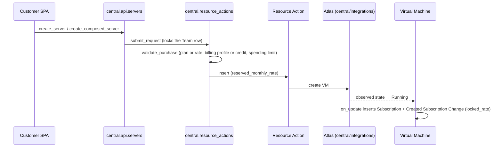
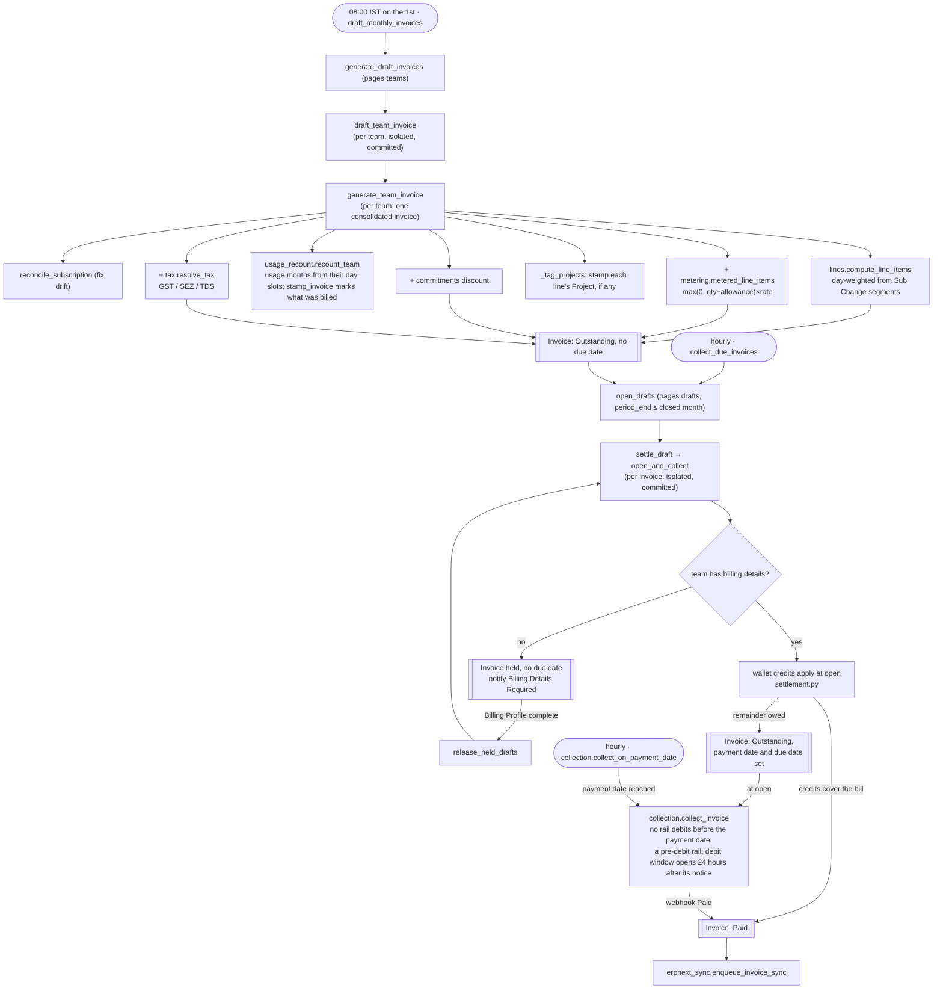
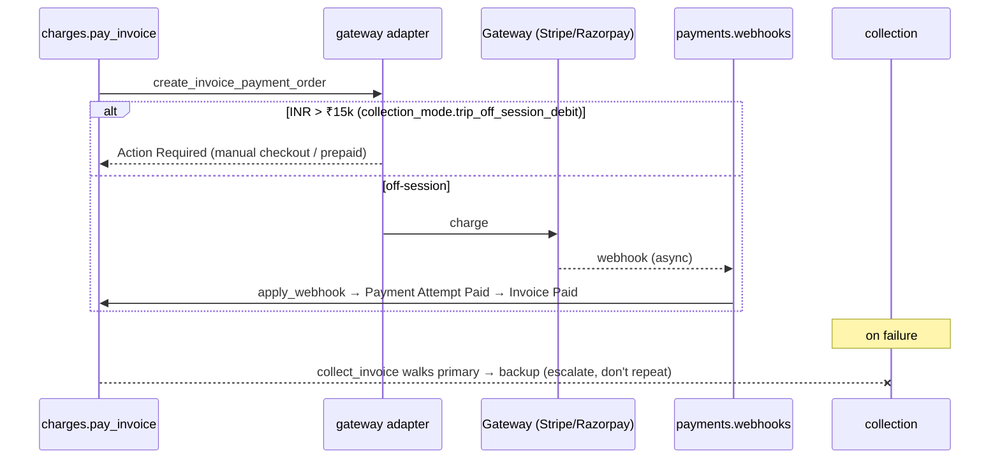
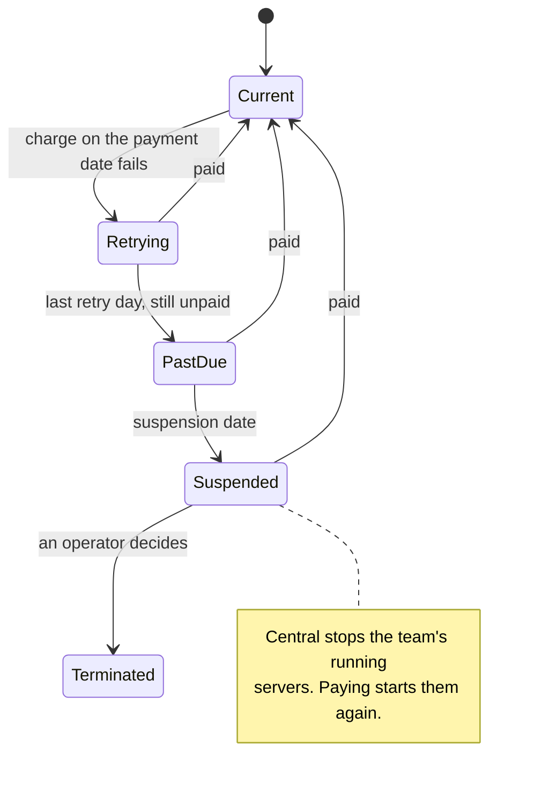
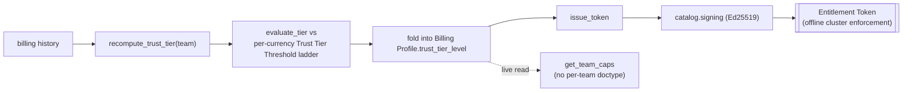

# Billing — Architecture & Debugging Map

> A glance-view of the `central.billing` module: what the sub-modules are, how they
> link, what triggers them, and where to look when something breaks. Start here, then
> jump to the named file. Paths are relative to `central/billing/`.
>
> 👉 To **stand up & demonstrate** billing from an empty site, see
> [`SETUP-AND-DEMO.md`](./SETUP-AND-DEMO.md). For the metered services API, see
> [`docs/metered-services-api.md`](./docs/metered-services-api.md).

Billing is a **postpaid, in-arrears** money system: Central provisions resources, records
the runtime it bills from, draws up an invoice in arrears, settles it (credits → card),
and chases the unpaid ones. There is **no Subscription Agent** (ADR 0006) — Central
provisions/records/enforces directly. Authorisation is Central's capability IAM
(ADR 0004), not billing-owned roles.

- Money is **float `Currency` in major units** (₹10.00 is stored `10.0`). Conversion to gateway minor
  units (Razorpay paise / Stripe cents) happens **only at the gateway boundary**. ADR 0003
  (integer minor units) is **DEPRECATED — it was never implemented**; don't design against it.

---

## 1. Layered sub-module map



Read top-to-bottom — each layer calls the one below it.

| Layer | Package | What it owns |
|---|---|---|
| **API, customer** | `api/dashboard/` | Team-scoped reads and actions for the customer SPA (`account`, `catalog`, `invoices`, `methods`, `outlook`, `projects`, `reports`, `services`, `spend`). |
| **API, admin** | `api/admin/` | Billing-Admin views: `catalog`, `revenue` (cost-explorer), `teams`, `gateways`, `projection`, `rerating`, `services`. |
| **API, pilot** | `api/billing_api.py` | X-Pilot-Token facade for a bench: payment methods, plans, metered services, credits, checkout. |
| **Catalog** | `catalog/` | The product & pricing authority: taxonomy masters, Plan Configurator, composed-config pricing, rate resolution, subscriptions (intent + state), trust tiers, entitlement signing. |
| **Revenue** | `revenue/` | Turning usage into money: `invoicing/` (draft→open→collect), `metering`, `credits`, `tax`, `commitments` discount, `dunning`, `pricelock`. |
| **Payments** | `payments/` | Moving the money: `charges`, `collection` (fallback), `collection_mode` (INR ₹15k gate), `mandates` (UPI), `emandate` (RBI), `payments` (cards), `webhooks`, `reconciliation`, `refunds`, `settlement`, `profile`. |
| **Ingester** | `ingester/` | Every sync with the accounting system: `connection` (HTTP client and sync mode), `customer` (customer, address, contact), `advance` (top-up advance), `erpnext_sync` (Sales Invoice push), `payment_records` (card payment and promotional credit against a Sales Invoice), `push` (operator preview and send). |
| **Gateways** | `gateways/` | The adapter seam: `base.GatewayAdapter` + `stripe`/`razorpay`/`paypal` + `registry`. |
| **Platform** | `platform/` | `notifications` (sole sender), `sync` (record the runtime billed from), `alerts` (operator alerts, including `held_invoices`), `invariants` (money audit), `constraints` (DB constraints), `metrics`. |
| **Projection** | `projection/` | Cost projection and scenario engine for the admin `projection` API. |
| **Authz** | `authz.py` | Capability checks (delegates to `central.iam`). |

Cross-cutting reference data: `india_gst.py`, `regions.py`, `catalog/taxonomy_setup.py`.

---

## 2. Data model — the DocType graph



Grouped by concern. `→` = Link field; **[C]** = child table; **[1]** = single.

**Catalog / product**
```
Resource Type
Plan Category ──allowed_resource_types─→ [C]Plan Category Resource Type ─→ Resource Type
Plan Sub-Category ──category─→ Plan Category
Plan ──category─→ Plan Category, ──sub_category─→ Plan Sub-Category, ──includes─→ [C]Plan Includes ─→ Resource Type
Catalog Rate ──priced_doctype─→ DocType, ──priced_for─(dynamic)→, ──cluster─→ Region, ──currency
Plan Configurator ─→ Category, Sub-Category, [C]base_rates, [C]rungs(─→Plan), [C]simple_plans(─→Plan)
```

**Subscription / state**
```
Subscription ──team, ──project─→ Project, ──plan, ──sub_category, ──includes─→ [C]Plan Includes,
             ──default_payment_method, ──gateway, ──server_id─→ Virtual Machine,
             ──vm_snapshot─→ VM Snapshot, ──public_ip_server─→ Virtual Machine (a public IPv4 billed before the per-day cutover; none opens now),
             cluster (read-only, from server_id.region), service_subject
Subscription Change ──subscription, ──team, ──currency      (append-only history + locked_rate)
Project ──team, ──title, ──enabled, ──spending_limit          (cost-tag + run-rate cap; see §2.1)
```

**Invoice / money**
```
Invoice ──team, ──items─→ [C]Invoice Line Item
Invoice Line Item ──project, ──project_title                  (snapshot tag, stamped at generation; see §2.1)
Payment Attempt ──invoice, ──team, ──gateway, ──payment_method, gateway_order_id   (on-session and hosted payments)
Top-up Order ──team, ──gateway, ──ledger_entry, gateway_order_id    (a wallet top-up, stored before the payer acts)
Refund ──payment_attempt, ──invoice, ──team
Credit Ledger Entry ──team, ──currency                        (append-only)
Credit Wallet ──team                           (lock anchor / cached balance — one per (team,currency))
Commitment ──team, ──currency              (spend floor)
Usage Rollup ──team                            (a metered total a service reports directly, and its re-priced versions)
Usage Month ──team, ──subscription, ──invoice  (one subject's metered values for one UTC month, one slot per day, per dimension such as the AI model; the rated row of a month also holds its quantity and terms)
Usage Month Correction (child)                 (a later value for a day an invoice already billed)
Usage Report ──service                         (one accepted report, or one read or estimate by Central, with its raw body as evidence)
Usage Segment ──team, ──service                (one stretch of time a subject held a quantity of a state meter, such as a server's public IPv4; added and closed once, never edited or deleted)
Usage Check                                    (Central's own reading of a pushed service's day, against the stored day; kept 7 days)
Monthly Exchange Rate                          (the USD rate one month bills converted usage at: the rate API's rate for the 1st, kept from the 2nd or at the month's draft)
```

Two kinds of "segment": a Subscription Change segment is a billed window of a subscription at one locked rate (Created or Resumed to Paused or Cancelled); a Usage Segment is a stretch of time a subject held a quantity, and it bills only where it meets such a window.

Money records (Invoice, Payment Attempt, Refund, Credit Ledger Entry, Credit Wallet, Usage Day, Usage Month, Usage Rollup, Usage Report, Usage Segment, Webhook Event, Billing Event, Top-up Order) are read-only in Desk and keep a change history, except Usage Day, Usage Month, Usage Report and Usage Segment, which billing writes in bulk. A Usage Segment is only inserted and then closed once: its controller refuses every other change and every delete, so an operator corrects one by closing it and opening the next (source Operator). Usage Day is retired: the patch `fold_usage_days_into_months` folds it into Usage Month and it is kept read-only. `platform.records` refuses an edit or delete that billing code did not make through `save_billing_record` or `delete_billing_record`, Administrator included. The `ignore_permissions` flag alone does not allow the change. A `db_set` or `frappe.db.set_value` write does not run validation, so it needs no mark. A person changes them through the action that owns the change: cancel, refund, retry.

**Payment plumbing**
```
Billing Profile ──team, ──currency, ──country, ──trust_tier_level, is_internal   (currency = source of truth, locks after activity)
Payment Method ──team, ──gateway
Payment Gateway ──currencies─→ [C]Payment Gateway Currency
Gateway Customer ──team, ──gateway             ((team,gateway) → customer_id)
Tax Profile ──team
```

**Trust tier / entitlement**
```
Trust Tier Level ──thresholds─→ [C]Trust Tier Threshold ──currency   (per-currency thresholds)
Entitlement Token ──team       (Ed25519-signed cap)
```

**Plumbing / logs**
```
Webhook Event ──gateway        | Billing Notification Log ──team
```

### 2.1 Project — cost tagging + a spending limit, one bill

A **Project** is a user-defined tag a team applies to its own Subscriptions — e.g. to
see what one internal team or customer costs inside an otherwise-shared bill. It is
**purely a cost-attribution + guardrail concept**: the team is always billed on **one
consolidated invoice per period**, exactly as if Projects did not exist. Tagging a
resource into a Project never changes who is billed, when, or on how many invoices.

**Invoice breakdown.** Every billable line (fixed or metered) is stamped with the
Project its resource is tagged into, if any — `Invoice Line Item.project` /
`project_title` — a snapshot taken at generation time (`revenue/invoicing/generate.py`'s
`_tag_projects`, called from `_rate`, the one function every line passes through for
both a real Invoice and a live forecast/cycle-tray read). An untagged resource, or one
tagged into a disabled Project, simply carries no project on its lines — it still bills
normally, just without a label. `Invoice.period_key` is plain
`team|period_start|period_end` (ADR 0018, invariant I6) — a team is billed at most once
per period, full stop; Projects add no dimension to that grain.

**Spending limit.** A Project optionally carries `spending_limit` — a cap on its
**committed monthly run-rate** (the summed `locked_rate` of every subscription tagged
into it, `catalog.subscriptions.project_run_rate`). `Subscription.validate_project`
calls `catalog.subscriptions.enforce_project_headroom` whenever a subscription is newly
tagged into a Project (on insert, or when its `project` field changes), and refuses the
tag if the addition would push the Project's committed run-rate past its limit. This
blocks **new tagging only** — an already-tagged, already-running subscription is never
throttled or stopped by a limit added or lowered later; the same "blocks new, never
touches existing" shape as trust-tier headroom (`enforce_headroom`), scoped to one
Project instead of the whole team. 0 or unset = unlimited.

**No delete** — a Project with billing history is load-bearing (past Invoice Line Items
carry its name/title as a snapshot); disabling (`Project.enabled = 0`) is the retirement
path. `Subscription.validate_project` refuses a *new* tag onto a disabled Project for
the same reason it refuses a foreign one: silently tagging something that means nothing
would be worse than refusing it outright. Disabling does not untag existing
subscriptions, and re-enabling resumes tracking with no retagging needed.

**Deliberately out of scope**: Projects have no relationship to credits or payment
methods at all — there is one `Credit Wallet` per (team, currency) and one Payment
Method fallback order per team, neither scoped by Project in any way. A
team-level Commitment (volume discount) and cost projection both operate on the team's
whole set of resources; a Project is never a unit either reasons about, only a label
lines carry.

---

## 3. Trigger surface — what fires what



### Scheduled (`central/hooks.py` → `scheduler_events`)
Dunning, reconciliation, the e-mandate cycle, credit expiry, card expiry, setup expiry, accounting-sync retries and the subscription backfill run each row through `platform.jobs.each_isolated`: a savepoint and a commit per row, and a row that fails is logged to the Error Log and skipped, so it does not stop the rows after it.

| Cadence | Entry point | Purpose |
|---|---|---|
| daily | `revenue.dunning.run_dunning` | retries every `dunning_retry_interval_days` up to the due date → past_due → suspend on the suspension date (stops servers) → termination due (operator) |
| daily | `payments.charges.cleanup_payment_logs` | prune Payment Attempt / Webhook Event |
| daily | `projection.batch.prune` | prune old projection batches |
| daily | `payments.emandate.run_emandate_cycle` | backstop: INR ≤₹15k pre-debit notice → debit window opens 24 hours after the notice |
| daily | `catalog.subscriptions.backfill_missing_subscriptions` | Subscription for any Running Virtual Machine missing one |
| daily | `payments.settlement.run_billing_details_reminder` | ask credit-funded teams for the billing details their invoice will need |
| daily | `revenue.credits.run_credit_expiry` | write off expired promotional credit |
| cron `0 9 * * *` (system time, Asia/Kolkata) | `payments.top_up_reminders.run_top_up_reminders` | ask INR Prepaid / Auto Charge teams to top up 5 and 2 days before the payment date when the card or UPI would be asked for more than its limit on the payment date; page jobs on the `billing` queue |
| daily | `platform.invariants.run_invariant_audit` | audit the cross-table money invariants |
| daily | `payments.reconciliation.recheck_completed_refunds` | ask the gateway again about card refunds completed in the last 30 days; flag one that failed later |
| hourly | `payments.webhooks.retry_failed_webhooks` | apply again failed and lost webhook events |
| hourly | `payments.collection.collect_on_payment_date` | debit each pre-debit rail whose window has opened (e-mandate first debit), start the first charge on the payment date, run the single retry 24 hours after a failed first charge, and send the payment reminder the day before; a pre-debit rail is started no earlier than 24 hours before the payment date to send its notice |
| hourly | `payments.reconciliation.run_reconciliation` | charged-but-never-webhooked gateway scan and Pending refunds |
| hourly | `payments.setup_expiry.expire_unfinished_setups` | settle card and UPI (not PayPal) setups left Pending Validation for `SETUP_EXPIRES_HOURS` (24), oldest first, at most `SETUPS_PER_RUN`: activate a Razorpay mandate the gateway proves, remove and expire a Stripe card saved but never confirmed, expire the rest, and release anything older than `SETUP_RELEASE_DAYS` (7) without a notice; one `payment_method_setup_expired` notice per team per run, at most one per team in `NOTICE_COOLDOWN_HOURS` (24) |
| hourly | `payments.setup_expiry.retry_unfinished_releases` | queue `release_late_setup` again for released setups with no `setup_released_at` (a cancelled setup only once `CANCELLED_SETUP_RELEASE_DELAY_MINUTES` (30) old), oldest first, at most `SETUPS_PER_RUN`, for `RELEASE_RETRY_DAYS` (7); then leave one comment for an operator and stop |
| hourly | `platform.alerts.run_operator_alerts` | alert operators (invariants, readiness, failed webhooks, stale attempts, unsettled captures, held invoices, failed refunds, failed accounting syncs, silent services, usage mismatches) |
| cron `0 8 1 * *` (08:00 IST on the 1st) | `revenue.invoicing.draft_monthly_invoices` | after the UTC month closes at 05:30 IST: waive internal teams' unpaid invoices, start the month's Billing Run, then draft the just-closed month as page jobs on the `billing` queue |
| hourly | `revenue.invoicing.collect_due_invoices` | collect every uncollected invoice whose month has closed, as page jobs; record progress on the Billing Run once the draft tick has started it |
| hourly | `revenue.storage_bridge.read_storage_usage` | until Cargo reports usage itself: read every billed bucket, and each billed server's backup bucket, in pages of 100, one job per page, and keep each UTC day's peak in the day slot of the bucket's Usage Month, under one Usage Report per page; a failed bucket never stops its page, and the last page of a region writes one Error Log that names how many of the region's buckets the run could not read |
| hourly | `revenue.grove_bridge.read_ai_usage` | until Grove reports usage itself: subscribe AI teams that now have a billing currency, then read each AI team's cost per model that landed at Grove from the team's `usage_read_until` day through today (UTC), at most 7 days a run, as one day slot per model and landing day, under one Usage Report per page; a team read in full moves its `usage_read_until` to the last day read, so a missed hour, an outage or a late subscription is caught up; a team never read starts at the later of `Service.bill_from` and the day AI was turned on; a correction lands as a negative day; one Error Log per page names the teams it could not read, and their day does not move |
| hourly | `revenue.usage_recount.recount_changed` | fold Usage Days and recounted rollups an older worker wrote after the fold patch (`usage_fold.fold_stragglers`), write the day slots of the Usage Segments opened or closed since the last run (from the 1st of the month before) and today's slot of each open segment that has none yet (with yesterday), in pages of 500 through `platform.jobs.each_isolated` (`usage_segments.project_changed`), then recount the usage months whose day slots changed since the last run, as page jobs |
| cron `30 17 * * *` (12:00 UTC) | `revenue.usage_checks.sample_storage` | only while Cargo pushes storage (`Service.central_reads` off): read every billed bucket and each billed server's backup bucket once, in pages of 100 queued as `sample_team_page` and `sample_bundled_page`, with the same readers `storage_bridge` bills with, and keep the reading as a Usage Check for the next day's comparison |
| cron `30 7 * * *` (02:00 UTC) | `revenue.usage_checks.check_yesterday` | only for a service that pushes: mark a storage day whose stored peak is more than 1 % below Central's sample, read each AI team's landing day from Grove with `grove_bridge.read_days` (failures logged as "Usage check: N AI team(s) not read") and mark a model that differs by more than 0.01 USD, then delete Usage Checks older than 7 days; writes no day value |
| daily | `revenue.usage_corrections.write_off_expired` | mark Written Off each Open Usage Month Correction with a value higher than the billed one whose day was billed more than 90 days ago (a lower value is never written off), in pages of 500 through `platform.jobs.each_isolated`, with a comment on its Usage Month |
| daily | `revenue.usage_retention.prune_old_months` | clear the day values and slots of Usage Months older than 13 months with nothing left to bill; totals and terms stay |
| daily | `revenue.usage_retention.prune_reports` | delete Usage Reports received more than 13 months ago, with their body files |
| daily | `revenue.usage_retention.sample_report_bodies` | re-hash 20 random report bodies of the last 35 days and set `damaged_at` on each that no longer matches (readiness M6) |
| daily | `revenue.usage_ledger.fill_missing_days` | give a Level subject with no reading for a UTC day that ended 48 hours ago its last reading, marked estimated, under one Estimated Usage Report per service and run |
| hourly | `ingester.erpnext_sync.retry_failed_syncs` | Automatic mode only: retry Sales Invoice push (backoff window elapsed), and send at most 100 paid invoices that no sync tried, paid more than an hour ago |
| monthly | `payments.payments.expire_payment_methods` | flip cards past their printed month |

**Unfinished setups expire.** The hourly job takes Card and UPI Autopay Payment Methods that are Pending Validation 24 hours after they started, oldest first, at most `SETUPS_PER_RUN` (500). PayPal setups are left alone: the console does not offer them, and PayPal makes no payment token until the confirm, so there is nothing to remove. Card expiry also uses Expired, so `payment_method.is_expired_setup` (Expired with no `validated_at`) tells the two apart: the console list and the Pilot list hide an expired setup, the Payment Method Mix report counts it under Setup Expired, and a late confirm answers "This setup expired. Start again to add it." For each setup with a `setup_reference`, the job asks the gateway with the read-only `adapter.read_finished_setup` (Stripe: the SetupIntent or setup Checkout Session; Razorpay: a token-bearing authorised, captured or refunded payment on the setup order), and then:

- **Razorpay proves the setup finished.** The job activates the mandate through `mandates.activate_proven_mandate`, the same activation and ₹1 refund the browser confirm uses. The payment must be on the setup order, be captured, carry a token, be 100 paise in INR, belong to the method's Razorpay customer, and name no other team in its notes. A payment that does not match is logged and the row stays pending. The `payment.captured` webhook for a setup order activates the mandate the same way, so a customer who closes the browser after paying still gets an Active mandate. `payment.authorized` is ignored, and the job does not activate on an authorised payment, because the setup order auto-captures and only the captured payment is refunded. The Webhook Event row is locked and applied once. If another Active or Pending Validation method on the gateway already holds the token (the customer retried with the same card and finished the second setup first), the row is not activated: it expires (the job sends the notice) and `release_late_setup` refunds the ₹1 and keeps the token. The newest UPI choice also wins: if the team has an Active UPI Autopay mandate on the same gateway that was validated at or after this row's `creation`, the row is not activated, because activating it would retire the newer mandate (`_retire_superseded_mandates`). It expires and `release_late_setup` refunds its ₹1 and cancels its token; the newer mandate stays Active. Cards coexist, so an Active card never stops an activation. This applies only to the webhook and the job; the browser confirm activates as before. A capture that reaches a mandate already Active on the same token (the browser confirm ran on the authorised payment) queues the ₹1 refund, keyed `mandate-authorisation-refund::{payment_id}`.
- **Stripe saved the card but nobody confirmed it.** The job does not activate or charge it. It expires the row with the notice and queues `release_late_setup`, which detaches the card.
- **The gateway has nothing.** The row expires with the notice. A setup the gateway no longer has (Stripe `resource_missing`, Razorpay "does not exist") counts as nothing.
- **The gateway cannot be read** (`GatewayError`, timeout or unsupported). The row is skipped until the next run.
- **The setup is `SETUP_RELEASE_DAYS` (7) old.** The job expires it without a notice and queues `release_late_setup`, whatever the gateway says, so no row stays pending for ever.

The team gets one `payment_method_setup_expired` notice per run, in-app and by email, for setups that expired between 24 hours and `SETUP_RELEASE_DAYS` old, unless it added an Active method after the latest of them started, or was sent this notice in the last `NOTICE_COOLDOWN_HOURS` (24). `confirm_payment_method`, `confirm_mandate` and `activate_proven_mandate` lock the row (`for_update`) before they decide, so the job, the webhook and a confirm never both act on it. A confirm or a setup webhook that reaches an expired setup, or a cancelled one that was never validated, queues `release_late_setup`. The release reads the setup again and does its gateway work in its own job: it refunds a captured Razorpay authorisation (`mandates.refund_authorisation`, keyed `mandate-authorisation-{payment_id}`, so a repeat returns the first refund), then cancels the Razorpay token or detaches the Stripe card (`adapter.remove_saved_method`). It waits, without marking, while the payment is only authorised, and does not refund a payment that is already refunded. It keeps a token or card that another method on the gateway (not Cancelled) also holds, because Razorpay gives the same card and customer the same token, and leaves a comment instead. A token or card the gateway already cancelled, detached or no longer has counts as removed. When every step succeeded, or there was nothing to give back, the release sets `setup_released_at`. The method keeps its status. A release whose gateway read, refund or removal fails raises, so the job fails with an Error Log and `setup_released_at` stays empty. The hourly `retry_unfinished_releases` queues `release_late_setup` again for each released setup (Expired or Cancelled, no `validated_at`, a `setup_reference`) with no `setup_released_at`, oldest first, at most `SETUPS_PER_RUN`, each through `each_isolated`. It retries only rows whose `modified` (the time they expired or were cancelled; the release does not touch it) is within `RELEASE_RETRY_DAYS` (7). After that a row gets one comment ("This setup's release at the gateway did not finish in time…") and no more tries, so an operator refunds and removes it by hand; a filter on an empty `setup_released_at` lists them. The `mark_old_setups_released` patch set `setup_released_at` to `modified` on every released setup that existed before the field, so the deploy did not start a gateway call for each of them. A later confirm or setup webhook still queues the release for a marked row. An unfinished setup never blocks a new one: a new setup on the same gateway cancels the older Pending Validation setups that have no `gateway_method_id` yet. It does not queue their release: `retry_unfinished_releases` queues it once the cancelled row's `modified` is `CANCELLED_SETUP_RELEASE_DELAY_MINUTES` (30) old, so a retry with the same card can go Active first and the release keeps the shared token. A card or authorisation the gateway saved for a cancelled setup is still given back. A late confirm or setup webhook on a cancelled row queues the release at once, and it still keeps a token another live method holds. The other setups stay as they are.

- If a sweep batch rolls back after an activation, the ₹1 refund still runs, and the setup is released after `SETUP_RELEASE_DAYS` (7).
- A Stripe setup cancelled by a new setup and finished later in an old tab stays attached at Stripe. It is never charged, because only Active methods are charged.

**The scheduled run is paged.** At 08:00 IST on the 1st, after the UTC month closes, `draft_monthly_invoices` starts the **Billing Run** row for the month and drafts the closed month as page jobs. Every hour, `collect_due_invoices` collects whatever has drafted and, once the run has started, updates its row (counts, failures, completion). A lost worker stops one page only; the next hourly sweep picks up the rest. `run_monthly_billing` starts the same Billing Run row and does both phases inline in one job; use it only for a small site or a test.

The readiness check B5 flags a month with billing but no Billing Run after the draft tick has fired (its time is read from the cron in `hooks.py`), and drafts that waited more than 3 hours to be collected. It feeds the hourly operator alerts.

**The fan-out is two orchestrators, and neither of them does the work.** Each keyset-pages its subjects and enqueues a **page job** per slice: `draft_team_page(after, until)` / `settle_draft_page(cutoff, after, until)`, deduplicated on the slice's upper bound. A page job re-derives its slice from the bounds and works it in order. It commits after **each team / each invoice**. The page is the unit of *scheduling* and the team is still the unit of *work*, so a job killed at team 300 of 500 keeps the 299 it finished.

`collect_due_invoices` retries failed teams, then collects every uncollected invoice whose month has closed (`period_end <= the just-closed month`). A settled draft drops out of the scan, so you can run it again until nothing is owed. A late draft, or one a settle page left behind, is collected on the next run.

Not a job per team, deliberately. At a million teams that is a million redis
round-trips in one scheduler tick — a cron job runs on a **300-second** timeout
(`get_queue_name()` gives cron jobs the `default` queue), so it would be killed
around 150k teams having never handed out the rest, and a million queued jobs is
gigabytes of redis. Two thousand page jobs cost seconds and megabytes.

**The billing queue is the throughput knob and the rate-limit cap, at once.** A fanned-out run uses its own queue, not `long`, configured in `common_site_config.json`:

```json
"workers": {"billing": {"timeout": 3000, "background_workers": 8}}
```

Because a page job works its invoices *sequentially*, the number of billing workers
is exactly the number of gateway charges in flight. That is the only thing standing
between a million-invoice month and a wall of 429s — there is no token bucket yet, so
**this number is the rate limit**. Set it against the gateway's documented ceiling
(Stripe ≈ 100 req/s; a charge is ~2s, so W workers ≈ W/2 req/s). Raising it is how
you go faster; there is no other dial. `billing_queue()` falls back to `long` with a
warning if the bench hasn't declared the queue — enqueuing to a queue nobody consumes
would mean the month silently never gets billed.

A unit that fails is contained: logged to the billing log file *and* as a
`Billing Run Failure` Error Log row, rolled back to its own savepoint, and kept as a Failed **Billing Run Team** row. `retry_failed_invoices` tries each Failed row again every hour, for any closed month. If the savepoint itself is gone —
the database restarted, the connection dropped — the failure is **re-raised** instead:
that is the machinery breaking, not a bad team, and containing it would turn one
outage into a silent run in which nobody was billed.

The run bills on the 1st, not the 28th. A calendar month billed in arrears is not closed until it ends, so drafting on the 28th would bill days that had not happened.

`billing_run_status()` reports what the current period's run has achieved (drafted / pending / collected / failures). It derives this from the tables, not from a counter. Read it before you run a period again.

**Worker math.** One collected invoice ≈ 2s (rating is ~100ms; the rest is the gateway
round-trip). Sequentially, a million invoices is ≈ 23 days. Over W billing workers it is
1M × 2s / W: **8 workers ≈ 69h, 32 ≈ 17h, 64 ≈ 9h** — and 64 workers is ~32 charges/s,
still inside a 100 req/s gateway ceiling. Drafting is cheaper (~0.3s/team): 1M teams
over 32 workers ≈ 2.6h. Size the pool from the
team count, never from the invoice amount.

**What the run actually contends on.** The tables a draft reads — Subscription,
Subscription Change, Payment Method, Catalog Rate, Usage Rollup — are read with plain
consistent reads, which under InnoDB MVCC take **no locks at all**, so no number of
workers can make them block each other. Credit Wallet *is* locked `FOR UPDATE`, but the
key is (team, currency): a team only ever contends with its own concurrent top-up.

Provisioning is the one path that does lock those tables: deciding whether credit covers
a new server is a read the caller then acts on. A create request holds the Team row, reads
its pending Resource Action reservations `FOR UPDATE`, then takes the wallet anchor and
reads Subscription + Subscription Change `FOR UPDATE` behind it. Otherwise two creates
clear the same balance. Every read is an index range scoped to the one team, and the order
is always Team, pending requests, wallet. The run is unaffected: a plain consistent read
never waits on them.

There is exactly one **global** lock in the run, and it is not a data table. Every
Invoice insert calls `make_autoname("INV-YYYY-MM-.#####")`, which takes the `tabSeries`
row `FOR UPDATE` and holds it **until the transaction commits** — so every worker in
the run queues behind one row. Measured on a dev bench: ~6ms held per invoice, i.e. a
ceiling of **~169 invoices/sec however many workers you add**, or ~1.6h for a million.
That sits *above* the worker-bound rate until roughly 50 billing workers (at ~0.3s of
rating per team, W workers deliver W×3.3/sec), so it is a ceiling to know about, not
one to design around yet. If you ever need past it, shard the series — `INV-YYYY-MM-A-`,
`-B-`, … per page — which GST permits as long as each series is itself consecutive.

Two things keep that lock short, and both are load-bearing:

- **One team = one transaction = one commit**, inline and fanned out alike. A page job
  that committed once at the end would hold the series row for 500 teams — minutes —
  and every other worker would hit `innodb_lock_wait_timeout` (50s by default). The
  commit inside the page loop is what makes the critical section milliseconds.
- **Contention is retried, not contained.** A lock-wait timeout (1205) or deadlock
  (1213) means the team lost a race, not that its data is bad. `draft_team_invoice`
  retries it with jittered backoff (`CONTENTION_RETRIES`), because the draft tick comes
  round once a *month* — a contained loser would go unbilled until someone noticed.
  Only after the budget is exhausted is it recorded as a `Billing Run Failure`.

**A late run never costs the customer grace.** `payment_date`, `due_date`, `dunning_starts_on` and `suspends_on` are all set from the day the invoice is actually *opened*, so a run three days behind bills three days later rather than three days overdue. Beyond that, any collection failure on our side (a 429, a dead worker, a contained run error) calls `dunning.defer_dunning`. It moves `dunning_starts_on` forward to today, and moves `suspends_on` and the end of the retry window forward by the same number of days. It never moves `due_date`, which is an accounting fact AR aging depends on. It is monotonic and self-limiting: a successful ask stops pushing, so a broken gateway defers *escalation*, not collection.

### Invoice status

An invoice is `Outstanding` from creation. The due date marks that collection began. An Outstanding invoice with no due date is not issued yet. It is not charged or dunned, and its `hold_reason` says what it waits for. Receivables, outstanding totals and open invoice counts include only issued invoices that are not settled. `central/billing/doctype/invoice/invoice.py` owns this definition (`is_issued`, `is_owed`, `is_unissued`, `issued_filters`, `owed_filters`, `unissued_filters`).

### Why a team has no invoice

**Billing Run Team** keeps the outcome of the run for each team and month: Invoiced, Nothing to Bill, Below Minimum or Failed, with the reason. The **Billing Run Coverage** report shows every team that existed by month end with one result and its reason: Invoiced, Waiting, Needs Action, Waived (Internal), Below Minimum, Nothing to Bill or No Subscription. The results add up to the team count. The top of the **Billing Day** dashboard shows the same counts. Its SQL query repeats the report's rules, so change both together. It also lists the settings that an operator must set by hand. The same list shows as a banner at the top of the **Billing** workspace, for a System Manager only, and only while a value is missing. A run cannot reach Complete while a team is Failed.

A month whose total is below the **Minimum Invoice Amount** for its currency (Billing Settings) gets no invoice. The amount is written off, and a Below Minimum row and a Billing Event record it. The minimum is the smallest charge the payment gateways accept (`settings.GATEWAY_MINIMUM_CHARGES`: INR 1 and USD 1, from the Razorpay limit of 100 subunits). Billing Settings does not accept a higher minimum, because a month that a gateway can charge must be invoiced.

### Billing activity

Every billing step adds a **Billing Event**: profile, subscription, customer sync, invoice and payment. Each event has a flow and an outcome. The code that writes the event states a failure, and an event with no outcome is a success. A status move to Failed is a failure. Use the **Billing Activity** report to find a failure by team, flow or outcome.

### Accounting records

**Sync mode.** Billing Settings holds the connection to the accounting system (Accounting tab): `accounting_url`, `accounting_api_key` and `accounting_api_secret` (a Password field). `accounting_sync_mode` sets what Central sends:

| Mode | Reads (GSTIN lookup, company state, setup check, GST state backfill) | Sends on change, daily sweeps, hourly retry | Invoice held as "Accounting Sync" | Operator Preview and Send Now |
|---|---|---|---|---|
| Off | No | No | No | No |
| Manual | Yes | No | No | Yes |
| Automatic | Yes | Yes | Yes | Yes |

`connection.enabled()` is true in Manual and Automatic. `connection.is_automatic()` gates every trigger: `customer.enqueue_sync`, `enqueue_for`, `awaiting_records`, `sync_pending_profiles`, `advance.enqueue_sync`, `sync_pending_advances`, `erpnext_sync.enqueue_invoice_sync`, `retry_failed_syncs`, and the accounting steps of `corrections.run_cancellation`. Records made while the mode was Off or Manual are sent when it becomes Automatic: the daily sweeps and the hourly never-sent sweep pick them up.

**Operator send.** Billing Profile, Credit Ledger Entry (a paid top-up) and Invoice have an Accounting group on the form for an operator while the mode is not Off. Preview shows the payloads a send would post and writes nothing (`push.preview`). Send Now (`push.push`) sends the record and what it needs first: the team's customer, address and contact, then every top-up of the team without an advance, then the Sales Invoice and card payment, then the credit notes and payments of its refunds (`corrections.next_accounting_step`). Each step runs through `platform.jobs.each_isolated` and commits on its own, so a failure keeps what was made and a retry does not make it twice. The send stops at the first step that fails and shows its error; the Error Log links to the record. A lock per customer, advance, invoice and cancellation keeps an operator send and a job apart.

A team gets a customer in the accounting system only when it has an enabled subscription, a live invoice or a paid top-up. A waived invoice is never sent, and its sync status is Not Required.

**Existing customers.** Before the customer sync makes a Customer, it looks for the team's customer that is already in the accounting system (`customer_match.find_existing`), because Press v1 made most of them. A customer is the team's when a contact with the team owner's or the billing email is linked to it, its name is the same as the legal name (ignoring case and spaces), its currency is the same, and one of its addresses is in the same city and country (ignoring case). One such customer is used with that address and contact, and a Billing Event "Customer Reused" names it; the sync then makes only what is missing. None makes a new customer. More than one stops the sync with an error that names them, and an operator picks one with **Use Existing Customer** on the Billing Profile (`customer.use_customer`, which refuses another currency and a team that already has a customer). The update pass re-enables a disabled customer, and keeps the address's and contact's other links, emails and phones: it adds what Central sends and drops nothing.

**What the Sales Invoice carries for the print.** The print format on frappe.io (Billing Settings' `invoice_print_format`) reads two custom fields of Sales Invoice, which `ingester/invoice_snapshot.py` fills. `frappe_cloud_invoice_id` is the Central invoice name; the sync finds an issued Sales Invoice by it (not a credit note, which carries the same id) before it makes one. `frappe_cloud_invoice` is the invoice as JSON in the shape Press v1 sent: `type` "Subscription", the billing period and due date, one item per invoice line (`document_name`, `plan`, `description`, `rate`, `quantity`, `amount`, none of them null) and `applied_credits`, the promotional credit the Sales Invoice leaves out, so the lines less it give the Sales Invoice total. A credit note carries `type` "Refund" and one line for the amount it gives back. Each Sales Invoice and partial credit note also carries Billing Settings' `invoice_letter_head`, and `invoice_terms` as `tc_name` with that record's text as `terms`, since the accounting system does not fill the text in on a save through its API. The setup check reports a missing custom field, because the API drops an unknown field without an error.

**Invoice and receipt PDFs.** The accounting system renders a PDF slowly, so Central asks for one only when someone downloads it: the console's invoice and top-up receipt downloads and `server_billing.get_server_invoice_pdf` go through `pdfs.stored_pdf`. The first download renders it with the configured print format and keeps it as a private File on the record (`Invoice.pdf_url`, `Credit Ledger Entry.receipt_url`); every later download is served from that file. A GET request commits only when it sets `frappe.local.flags.commit`, which the first download does. Two first downloads at once both render; a row lock keeps one file. An operator's **Fetch PDF Again** (Invoice or Credit Ledger Entry form) drops the file, so the next download renders it again, for example after a print format change. When an invoice is synced in Automatic mode, the team gets an "Invoice Ready" notice (`invoice_ready`) that links to its invoices; in Manual mode it gets none, so a test sync does not reach a customer.

**Accounts per currency.** Each row of Billing Settings' Accounts per Currency names the receivable, advance, income and wallet clearing account of one currency (`settings.receivable_account`, `advance_account`, `income_account`, `wallet_clearing_account`). INR is the customer in India and USD the customer outside it. The customer sync puts the receivable and advance account of the team's currency on the Customer's Party Account row (`customer._party_accounts`), because ERPNext books an advance to the advance account it finds on the customer, else the company's one, whatever the Payment Entry names. The Sales Invoice lines and a credit note's lines use the income account of the invoice's currency; a top-up advance and a refund's new advance use the advance account of its currency. The setup check (`ingester/setup.py`) checks that each account is in the company, is not a group, is in its row's currency (not the income account), and is of the kind ERPNext accepts there: a receivable is Receivable under Assets, an advance is Receivable under Liabilities, an income account is under Income.

**GST on documents.** `ingester/gst.treatment` gives the GST category, place of supply and tax template that the Sales Invoice and the top-up advance carry. It decides SEZ zero-rating with `tax.has_zero_rating`, the same rule `tax.resolve_tax` uses, so an SEZ team whose GSTIN lapsed is filed with the GST it was charged. An Indian profile with no state has no place of supply and gets the out-of-state template (IGST). The console asks a member with `billing:manage` for the state and shows the IGST rate charged meanwhile (`gst_state_missing` and `igst_rate` on `get_billing_profile`). A customer save of an Indian billing address (`payments/profile.create_or_update_billing_profile`, with any address field) must name the state. Other saves of an existing profile without a state still go through.

**GST state on the invoice.** An issued invoice records the team's billing state in `Invoice.gst_state`, so a team that adds or changes its state later does not change how old invoices are filed or labelled. `gst_state_recorded` is set with it, so an invoice issued to a team with no state (blank `gst_state`, recorded) differs from one not recorded yet. `lifecycle._retax` records both at issue through `tax.gst_state_at_issue`, only when the invoice charges GST in India; SEZ and untaxed invoices are not recorded. `gst.treatment(team, invoice=...)` takes the place of supply and the template from the recorded state and the company's live state, so the two always agree; an invoice not recorded yet uses the team's current state. `erpnext_sync.build_sales_invoice` and the GST returned to the wallet by a refund (`corrections._advance_again`) use it. A top-up advance is a separate supply and uses the team's current state. `tax.TaxNames` names the split to show ("CGST 9% + SGST 9%" or "IGST 18%") from the same state and the cached company state. The daily long-queue `ingester.gst_state_backfill.record_missing_gst_states` job records the state on issued GST invoices from before: a synced invoice takes the place of supply on its Sales Invoice, an unsynced one the team's state at issue from the Billing Profile's Version history (issue time from the invoice's Billing Event), else the current state. It reads at most 1000 invoices a run in pages of 100. When sync is off or the accounting system cannot be read, it pages only unsynced invoices and the synced ones wait. A filed place of supply it cannot map is left unrecorded with a warning, not recorded as no state.

### Operator alerts

`platform.alerts.notify_operators(title, alerts)` sends every billing alert for operators. No other billing code mails operators. Customer notifications use `platform.notifications` and do not change with these settings.

Configure it in **Billing Settings → Operator Alerts**:

| Field | Purpose |
|---|---|
| Alert Channel | `Raven` (default), `Email`, or `Raven and Email`. |
| Alert Email Addresses | One address per line. Required when the channel includes Email. Central never mails the System Manager role. |
| Raven Site URL, Raven Channel ID | The Raven site and the channel that gets the alerts. |
| Bot API Key, Bot API Secret | The API key of a bot user that is a member of the channel. The alert is posted as this user through `raven.api.raven_message.send_message`. |
| Muted Alerts | Billing alerts the hourly digest does not send. Choose a **Category**: Payments, Invoicing, Dunning, Money checks, Readiness checks or Metering. Leave **Alert** empty to mute the whole category, or choose one alert or one check in it. **Until** is when the alert is sent again; leave it empty to mute until the row is removed. Enter the reason, for example the ticket of the known issue. `platform/kinds.py` owns the categories. |

When a Raven post fails, or Raven is not configured, the alert goes to the email addresses once and the failure is written to the Error Log. Use **Send Test Alert** on the form to check the saved settings. The hourly digest keeps one Error Log row for each digest it sends, and it does not send the same digest again for `REPEAT_AFTER_HOURS`. A muted alert is left out of the digest and counted as `muted` in the `billing.alerts` metric. Muting applies only to the hourly billing digest (`run_operator_alerts`). Signup alerts, the setup lockout alert and **Send Test Alert** are never muted. The message groups the alerts under a readable name, such as `B1 · Billing currency matches the country` or `Failed webhook`, and says what each group means: the first paragraph of the check's docstring, after `Expected:`, or of the alert source's docstring. Keep that first paragraph in plain words, because operators read it.

### Lifecycle / install hooks
- `after_install` / `after_migrate` / `before_tests` → `catalog.taxonomy_setup.ensure_catalog_masters` (idempotent seed of catalog masters, ADR 0007), `settings.ensure_snapshot_settings`, `platform.constraints.ensure_constraints`, `gateways.setup.ensure_gateway_records`, `navigation.ensure_workspace_sidebars` (also imports the workspace's Custom HTML Block). `after_install` and `before_tests` also run `settings.ensure_welcome_credit_amounts`.
- `doc_events`: `Team.on_update` → `payments.provisioning.on_team_update`. Server Subscriptions are not in `doc_events`: the Virtual Machine controller's `on_update` creates the Subscription when the server reaches Running and closes it when the server is Terminated.
- `override_doctype_dashboards["Currency"]` → `api.dashboard_overrides.currency_dashboard`.

### Inbound webhooks (`payments/webhooks.py`)
`@stripe` / `@razorpay` / `@paypal` (whitelisted, signature-first; PayPal is verified through its verify-webhook-signature API) → `process_webhook` → adapter `verify_webhook_signature`/`parse_webhook_event` → `handle_webhook_event`. Frappe Cloud v1 uses the same gateway accounts, so `is_central_event` first checks that the event names a record Central stored. Any other event gets a 200 and no row. A kept event is persisted to **Webhook Event** for dedupe/replay, with when the gateway raised it (`occurred_at`), Razorpay's `X-Razorpay-Event-Id` header for tracing (`delivery_id`, never used for dedupe because it is outside the signature) and a count of `deliveries`: a repeat delivery adds one in a small background job, so the request never waits on the row lock of the event's own job, and enqueues no second processing job. The patch `remove_webhook_events_of_another_product` applies `is_central_event` to the stored body of each Ignored Webhook Event that is not linked to a Payment Attempt or a Payment Method. It deletes only the events that the rule rejects, together with their `Webhook Event Ignored` Billing Events. It keeps an event whose body is not a JSON object.

`handle_webhook_event` sends each event to one handler. The handler links the Webhook Event to the Payment Attempt or Payment Method it is about, so the record's Connections show its event history.

**When a handler fails.** Its writes are rolled back to a savepoint, the event becomes Failed with the traceback in Error and its Tries count goes up. `retry_failed_webhooks` runs hourly and applies again every Failed event under `MAX_TRIES`, and every Received event older than `STALE_RECEIVED_MINUTES` (its job was lost). `platform.alerts.failed_webhooks` pages an operator while an event stays Failed. A Razorpay event is deduped on an id built from the signed body (event, `created_at` and entity ids), because the `X-Razorpay-Event-Id` header is outside the signature. A gateway cannot be enabled without a webhook secret, and a missing secret or signature verifies nothing.

| Events | Handler | Effect |
|---|---|---|
| `payment_intent.*`, `payment.*`, `PAYMENT.CAPTURE.*` except `PAYMENT.CAPTURE.REFUNDED` | `charges.apply_webhook` | Authorised, Captured or Failed. `payment_intent.canceled` fails the attempt with Stripe's cancellation reason. A PayPal PENDING capture keeps the attempt open (`gateway_hold_until`) instead of failing it. |
| `charge.dispute.*`, `payment.dispute.*`, `CUSTOMER.DISPUTE.*` | `disputes.apply_dispute` | Note on the invoice; a lost dispute cancels the invoice without a second refund. A lost dispute on an invoice that is no longer Paid, or on a charge captured after the invoice was paid, is flagged for an operator. |
| `charge.refund.updated`, `refund.failed`, `refund.processed`, `PAYMENT.CAPTURE.REFUNDED` | `corrections.apply_refund_event` | Finishes a Pending refund as Completed or Failed. Reconciliation asks the gateway about any Pending refund the webhook missed. Once a day it also asks the gateway again about each refund to the card that paid (destination Source) that completed in the last `COMPLETED_REFUND_RECHECK_DAYS` (30) days, so a refund that failed later is flagged when its webhook does not arrive. When the gateway reports Failed for a refund that is already Completed, the refund and its charge keep their state. Central adds a comment on the invoice and an Error Log `Refund failed after completion on <invoice>` that names the refund and its gateway refund ID, so an operator can pay the customer back. |
| `mandate.updated` | `mandates.apply_mandate_event` | A revoked mandate cancels its Payment Method. |
| `payment_method.detached` | `payments.apply_payment_method_event` | The card is cancelled and leaves the charge order. |
| `setup_intent.setup_failed` | `payments.apply_payment_method_event` | The failure code, decline code and message on the card, its failed attempt count, and a `Payment Method Setup Failed` Billing Event. The card stays Pending Validation, because the customer can retry on the same SetupIntent. Central finds the card by the SetupIntent: an in-app setup keeps it as the Setup Reference, and a hosted setup keeps it as the Setup Intent ID. |
| `charge.refunded` | none | Stored only. A refund made in the gateway dashboard leaves no Refund record. |

**Subscribed events.** Each adapter's `webhook_events` lists the events Central subscribes to. `test_payment_gateway.TestWebhookEventList` fails when a handled event is not in that list.

**Webhook endpoint.** On the Payment Gateway form:

- **Register Webhook** (or **Re-register Webhook** when an endpoint exists) checks the keys and creates a new endpoint and a new signing secret. The old endpoint is not deleted at the gateway. When no new endpoint is registered, for example on a local site, the current endpoint and secret are kept.
- **Webhook Events → Pull** reads the endpoint from the gateway and fills the Webhook Events table. Each event is OK, Missing (Central needs it, the gateway does not send it) or Not Used.
- **Webhook Events → Update** sets the endpoint's events to the adapter's list. The signing secret does not change.

When you save new keys, Central reads the stored endpoint with them. If the keys can see it (same account), Central adds any missing events. If they cannot (another account, or Stripe test keys changed to live keys), Central registers a new endpoint. Central never deletes an endpoint at the gateway, because another site can use the same account. A PayPal gateway that settles through Razorpay has no webhook of its own. PayPal calls go to the sandbox host unless site config `paypal_api_base` is `https://api-m.paypal.com`; no other host is accepted, because the client secret is sent there.

### API entry points (`@frappe.whitelist`): see §5 per package.

---

## 4. Key end-to-end flows

### A. Create a server (customer creates a server)

```
central.api.servers.create_server | create_composed_server
  → central.resource_actions.submit_request         (locks the Team row)
      → validate_purchase
          → plan from get_server_plans, or composition.validate_composition + pricing.resolve_config_rate
          → resource_actions.require_payment_method_or_credit(team, rate + reserved_rate(team))
          → spending-limit check against the catalog's available headroom
      → Resource Action (carries reserved_monthly_rate)
  → central/integrations → Atlas creates the VM
  → Virtual Machine.on_update (status Running)
      → inserts the Subscription and its Created Subscription Change (carries locked_rate)
```
`api/dashboard/catalog.provision_composed_config` still exists, but it only records a subscription. It does not create a server.

Resize: `central.api.servers.resize_server` → `catalog.subscriptions.begin_resize` (validates, persists a Resource Action) → `central.integrations.resource_actions` → `apply_resize_billing` → `resize_composed_subscription` → new Subscription Change (re-prices).

Pause and resume: `catalog.subscriptions.pause_billing` writes a `Paused` change on the server's subscription, which closes its segment. A public IPv4 day bills only when the address was held at a moment the server's segment was open, so a day paused throughout bills no address. `resume_billing` checks the team and project headroom, then writes a `Resumed` change that carries the rate locked before the pause. A Start on a paused server reopens its billing through the same headroom checks, and does not need `billing:manage`. A `Running` report from the region never enables a paused subscription again.

### B. Bill a period (draft → open → collect)

```
[cron 0 8 1 * *]  revenue.invoicing.draft_monthly_invoices   (settle_internal_teams, start the Billing Run, then page jobs)
  → generate_draft_invoices (pages teams)
  → draft_team_invoice (one team = one transaction = one commit)
    → generate_team_invoice (per team, aggregates every cluster it runs in)
      → reconcile_subscription (correct drift if stale)
      → lines.compute_line_items  (day-weighted, from Subscription Change rate-snapshot segments)
      → usage_recount.recount_team (first writes the day slots of the team's Usage Segments for the
        month and the month before, then usage months from the unbilled day slots; a month whose
        draft billed nothing is closed, and its late days go on the next month)
      → + metering.metered_line_items   (max(0, qty−allowance) × rate)
      → usage_recount.stamp_invoice marks exactly the month rows and day slots it counted; only
        reissue_invoice releases them, a cancel alone keeps them billed
      → _rate → _tag_projects stamps each line's Project (if its resource is tagged
        into one that's enabled, §2.1), then + commitments discount, + tax.resolve_tax
        (GST additive / SEZ zero / TDS withhold)
  → Invoice (Outstanding, no due date), one per team, same period, `period_key` keyed on (team, period)

[hourly]   revenue.invoicing.collect_due_invoices   (snapshot a started Billing Run, then page jobs)
  → open_drafts (every Outstanding invoice with no due date and period_end ≤ the closed month)
  → settle_draft → open_and_collect (per invoice)
      → billing-details hold: a Billable invoice keeps no due date if the team has no billing
        details (lifecycle._hold_for_billing_details, notifies "Billing Details Required")
      → wallet credits apply at once (settlement.py); credits that cover the bill settle it (Paid)
      → Invoice gets its payment_date and due_date
      → collection.collect_invoice at open: no rail debits before the payment date; a
        pre-debit rail sends its notice no earlier than 24 hours before the payment date, then waits 24 hours
      → (on webhook) Paid → erpnext_sync.enqueue_invoice_sync

[hourly]   payments.collection.collect_on_payment_date
  → emandate.charge_due: debit each pre-debit rail whose window has opened
  → every owed invoice with no payment attempt and payment_date ≤ tomorrow (no due date cut-off)
  → collection.collect_invoice (no rail debits before the payment date; a pre-debit rail sends
    its notice no earlier than 24 hours before it, and its debit window opens 24 hours after the notice)
  → dunning.run_single_retries: the single retry, 24 hours after the first charge failed
  → payment_notices.send_payment_reminders: invoices charged tomorrow, rails without a pre-debit notice
  → (on webhook) Paid → erpnext_sync.enqueue_invoice_sync
```
A held draft is released when the profile is complete. `Billing Profile.on_update` calls `release_held_invoices`, which enqueues `run.release_held_drafts` to settle the held drafts. When a draft waits longer than `Billing Settings.billing_details_grace_days`, the team stops being credit-funded for new spend (`settlement.details_overdue`), and `platform.alerts.held_invoices` pages operators.

Both ticks use `draft_team_page` and `settle_draft_page` page jobs (see §3).

**The card is charged on the payment day.** Each team has a payment day from the 1st to the 10th on its Billing Profile (default 1). When an invoice opens, wallet credits apply at once and the invoice gets a `payment_date`: the payment day of the month it opened in, or the opening date when the run is late. The due date is never before the payment date.

No rail debits before the payment date (`collection.collect_invoice`). A rail that owes the RBI pre-debit notice sends it no earlier than 24 hours before the payment date (`emandate.schedule_predebit`). Its debit window opens 24 hours after the notice, which is never before the payment date. On the default payment day, the 1st, the invoice opens on the payment date, so an e-mandate is debited on the 2nd. The hourly `collection.collect_on_payment_date` does four things in order. First it makes the first debit on each pre-debit rail whose window has opened (`emandate.charge_due`), so the debit does not wait for the daily `run_emandate_cycle`. An invoice with an attempt made in its window is left to dunning. Then it starts collection on each invoice that has reached its payment date, or reaches it tomorrow, and has no payment attempt. An invoice that missed its payment date is still picked up. An invoice charged in the first step has an attempt, so the second step skips it. Then it runs the single retry of each invoice whose retry window has no interval retry, 24 hours after its first charge failed (`dunning.run_single_retries`). Last, it sends the payment reminder (`payment_notices.send_payment_reminders`) for each invoice that is charged tomorrow, has no attempt, and is on a rail that owes no pre-debit notice. `Invoice.payment_reminder_sent_at` makes the reminder go out once. After the first charge, dunning owns the retries.

The customer changes the payment day at most twice in a billing cycle (`BillingProfile.change_payment_day`). The change applies to the next invoice. An open invoice keeps its date.

**Payment emails.** `payments.payment_notices` sends these events through `platform.notifications.notify`. Each is a Billing event for members with `billing:view`, in-app and by email.

| Event | When | Sent from |
|---|---|---|
| `payment_scheduled` | An invoice opens with an amount left after credit. It names the total, the credit applied, the amount to charge, the charge date and the payment method. The charge date is the pre-debit charge time on a rail that owes a pre-debit notice, else the payment date. With no method, it asks the team to add one. An INR bill above the team's off-session limit (or with no card or UPI saved) gets no `payment_scheduled`: the team gets `top_up_reminder` for that invoice instead, unless the first collection step already moved it to Action Required (that notice is the one notice), or it had a top-up notice that day. A Manual Checkout team keeps `payment_scheduled`. Otherwise, when the team has methods but none may take the amount off-session, it asks the team to pay by hand and names no method. | `lifecycle.open_and_collect`, after the first collection step, in the run that issues the invoice. A held invoice sends it when it is released and opens. |
| `top_up_reminder` | An INR team on Prepaid or Auto Charge whose card or UPI would be asked for more than its off-session limit on the payment date (no saved card or UPI counts as a limit of 0). It runs the collector's own draw without writing (`wallet_draw.plan_draw`, which `lifecycle._draw_wallet` spends): top-up credit pays the net and its prepaid GST pays the GST; promotional credit pays the bill GST included. At issue the wallet pays what it can and the card the rest, so before issue the card share is what the draw leaves; after issue credit pays only when it covers the whole `expected_collection` (`_settle_with_credit`), so the card share is that whole amount until the wallet covers it. The wallet counts only credit still valid on the payment date. The ask is the whole shortfall: the purchased credit X that, drawn last, makes the wallet pay the whole bill (`wallet_draw.TopUpAsk`). With g the bill GST per net as the collector draws it (with TDS, GST/(total − TDS − GST), which can be above the top-up rate r), gross = owed + top-up credit drawn + top-up GST drawn, net = gross / (1 + g), and `credit_to_cover` gives X = max(net − top-up credit drawn, (gross − net − top-up GST drawn − spare top-up GST) / r) (the second term only when r > 0): all purchased credit must reach the net of what it pays, and all top-up GST its GST, since older top-ups use the new GST first. That X rounded up to ₹100 always pays (one more ₹100 when the 2-dp draw misses by ₹0.01). It can ask too much when the GST left is short and promotional credit drawn later would pay more, so the ask is the least ₹100 step at or below it that pays, found with the collector's own draw (`TopUpAsk.is_paid_with`, the `wallet_draw.is_paid_by` check `_settle_with_credit` uses). A draft's GST may still change when ERPNext issues it, so an ask made before issue can be off by that change. Y = X + `credits.top_up_gst(X)` is what the top-up dialog charges for it. The message names both and the GST as the invoice files it (`tax.get_tax_names(team)["tax_label"]`: "IGST 18%", "CGST 9% + SGST 9%", or "No GST (SEZ)"; IGST when the billing state is unknown; the company state is cached a day (`gst.cached_company_state_code`), the last known one is used when a read fails, and while it was never known the label is "GST 18%") ("Add ₹X of credit … (₹Y incl. IGST 18%)"); with no GST on top-ups it names X only. When purchased credit was bought without its GST (the GST balance is below the purchased lots × the top-up rate, `wallet_draw.has_credit_without_gst`) and the draw takes GST for it (`plan_draw.gst_unpaid` > 0), part of the new top-up's GST pays for that earlier credit and X is more than the gap; the due carries `includes_earlier_gst` and the email, in-app notice and banner add "This includes GST on earlier credit that had none." A TDS bill's higher GST rate alone does not set it. A bill not issued yet takes its GST from the draft, or for a forecast from the team's rate today. The next bill is the issued invoice not yet charged; else, up to this month's payment date, last month's unissued bill (its held draft's total, or its projection); else this month's forecast paid on next month's payment date. 5 and 2 days before the payment date, never on it. At most one a day: the Billing Profile row is locked and a locking read of the `Top-up Reminder` log of that day stops the send. A team in Action Required is asked to add the amount "to pay this bill", with no limit named. The action, "Open billing", opens `/billing?team=<team>&topup=<X>`: the console switches to that team, and for a member who can manage billing opens the top-up dialog prefilled with the credit, whose "You pay" is Y. The engine sends one action to every recipient, so a viewer gets the same link and only the page. The day-before `Payment Reminder` skips such a bill, so it gets no "We'll charge" notice. `get_collection_status.top_up_due` feeds the same ask to the billing page banner. That read never trips Action Required: an Auto Charge team over its limit after the wallet sees the top-up banner; only a persisted Action Required shows the Action Required banner. | The daily `top_up_reminders.run_top_up_reminders`, and `payment_notices.notify_payment_scheduled` for an over-limit bill. |
| `payment_reminder` | 1 day before the payment date, when the invoice has no payment attempt. One notice per bill, decided in this order: a bill that gets the top-up notice gets no reminder; a bill no method may take off-session gets the reminder, which asks for a payment by hand and names no method; a rail that owes a pre-debit notice gets that notice instead; any other bill gets the reminder naming the method charged. Once per invoice: a conditional update sets `payment_reminder_sent_at` before the notice, and only the sweep that changes the row sends it. | The hourly `collection.collect_on_payment_date`. |
| `payment_date_changed` | The payment day changes, on the dashboard or in Desk. It names the new day, the next payment date, and an issued invoice that keeps its payment date. | `BillingProfile.on_update`. |
| `payment_retry` | A dunning retry fails. The message names the retry number and the reason. | `dunning.retry_payment`. |
| `invoice_overdue` | Dunning marks the invoice Overdue. The message names the action that settles it in the team's collection mode. While a charge is in flight, the message says the payment is still processing, that wallet credit added now avoids suspension on the suspension date, and that the charge is refunded if it also goes through. | `dunning.process_invoice_dunning`. |
| `payment_refunded` | A late capture Refund completes (see the already Paid case below). It names the paid invoice, the amount and the payment method. Once per Refund, when its status changes to Completed. | `Refund.on_update`. |

**How tax is named.** `tax.TaxNames(team)` names the GST of a tax block, one source for every screen and notice. `label(block)` gives "IGST 18%", "CGST 9% + SGST 9%" or "No GST (SEZ)" (None when no GST applies; "GST 18%" while the company state was never known). `note(block)` gives what follows a tax-inclusive amount: "incl. IGST 18%", or "SEZ supply, no GST" for an SEZ amount. Each label and note is one whole translatable phrase. `reason(block)` words a zero-rating. The rate and the SEZ zero-rating come from the block, so an issued invoice keeps the tax it was issued with. An issued invoice is named IGST or CGST + SGST by the state recorded on it at issue (`gst_state`, `gst_state_recorded`). A forecast, and an invoice issued before states were recorded, follow the team's billing state today (no state is IGST; a team outside India with no recorded state is plain "GST"). `TaxNames` reads the team's profile and the company state once, so a list of invoices costs one profile read. `tax.get_tax_names(team)` names the team's tax today, for a limit: `tax_label`, `tax_note`, and `limit_tax_note` (the note for an off-session limit, None for a team not taxed). The APIs send the names: `get_forecast` (`tax_label`, `tax_note` from the projected bill's tax block, which carries its `zero_rating_reason`, so a forecast with no GST, or with no projected bill, names none; `limit_tax_note` from `tax.get_tax_names`), `list_invoices` (`tax_note`), `get_invoice` (`tax_label`, `tax_reason`), `credit_ledger` (`tax_label` on a top-up with GST, from its own stored `tax_amount` and the rate that gives, `TaxNames.paid_label`, never the SEZ label; a top-up does not record its state, so the IGST or CGST + SGST split follows the team's state today), `get_next_payment` (`tax_note` from the owed invoice, else the projected bill's block, None with neither) and `get_collection_status` (`tax_note`, and `limit_tax_note` for the off-session limit). Only a ledger row paid in through a gateway (`gateway_payment_id`) gets a `credit_ledger` label: returned credit carries back a share of GST whose ratio is not a rate. `get_forecast` also sends `expected_collection`, the amount after TDS that the shortfall and the wallet's cover are measured against. The notices carry `tax_note` in their context and add it after each tax-inclusive amount, for example "₹ 11,800.00 (incl. IGST 18%)": Payment Scheduled (the invoice email), Payment Reminder, Pre-debit Notice (which also names the amount, `fmt_money`) and Action Required (on the off-session limit, `limit`, with `limit_tax_note`: only for a taxed team, since an SEZ note says nothing about a limit). The Top-up Reminder and the billing page banner add the same note to the limit they quote (`limit_tax_note` from `tax.get_tax_names`). `templates/emails/invoice.html` is not sent by billing. While the company state was never known, a failed read is not retried for an hour (`gst.MISSED_COMPANY_STATE_KEY`), so a page view does not call ERPNext or log an error each time.

**Forecast shortfall.** `get_forecast.shortfall` is what the card or UPI is left to pay after the wallet, drawn the way the collector draws it on next month's payment date (`wallet_draw.get_wallet_shortfall` over `plan_draw`; `wallet_draw.get_wallet_on` leaves out promotional credit that expires by then, the same read the top-up reminder uses): GST paid with top-ups pays the bill GST, and promotional credit pays the bill GST included. The overview's "Covers N% of this cycle" reads it. Spend-limit bars (Limits card, spend chart) compare spend before tax (`subtotal`, `measured`, `get_spend_history.months[].subtotal`) with the limit, which is set before tax.

### C. Collect / settle a charge

```
charges.pay_invoice → create_invoice_payment_order (via gateway adapter)
  → gateway charges off-session OR returns Action Required (INR > ₹15k, collection_mode.trip_off_session_debit)
  → webhook arrives → apply_webhook → Payment Attempt Paid → Invoice Paid
  → failure → collection.collect_invoice walks primary → backup methods (escalate, don't repeat)
```
**How a payment is matched to what Central asked for.** Before the payer acts, Central stores a row for the payment: a Payment Attempt for an invoice, a Top-up Order for a wallet top-up. Its name is the receipt sent to the gateway, and the gateway's order id (a Razorpay order, a Stripe PaymentIntent or Checkout Session, a PayPal order, a Razorpay Payment Link) is stored on it. The webhook, every confirm route, the pilot poll and reconciliation read the payment back as a `VerifiedPayment` (a server-side read or a signed webhook body) and find the row by the gateway's ids, or by `metadata.receipt` on Stripe, which only the secret key can set. Razorpay payment notes are never read, because Checkout lets the payer set them. The payment must be captured, in the row's currency, for at least its amount:

| Case | Result |
|---|---|
| No stored row | Nothing is settled or credited. The event is Ignored. |
| A declined payment on a Top-up Order | The order keeps the failure code, decline code, message and failed attempt count of the last decline. Each decline also adds a `Top-up Order Declined` Billing Event with its failure code. A repeated webhook adds no second event. The order stays Created, because the payer can try again. |
| A declined payment on a mandate authorisation order | The Pending Validation method keeps the failure, and a `Payment Method Setup Failed` Billing Event is added. |
| Short or another currency | Nothing is settled. The invoice gets a comment and an Error Log entry. |
| More than is due | The invoice is Paid and the surplus goes to the wallet. |
| The invoice is already Paid, by credit or by another charge | `refunds.issue_refund` returns the whole payment to its source and the attempt becomes Refunded. The Refund is marked `late_capture`. No wallet credit or advance is booked, and the refund steps make no credit note and no payment out in the accounting system for it, also when its webhook, a retry or a later cancellation runs them. A later cancellation, a partial refund and the card payment sent to the accounting system leave the charge out, so only `retry_failed_refunds` gives it back when its refund fails. The invoice gets a comment and an Error Log entry. The team gets `payment_refunded` when the refund completes. This is the normal end of a charge that was in flight when wallet credit paid the invoice (`lifecycle.settle_with_new_credit`). |
| The invoice is Cancelled or Waived | The payment goes to the wallet, once per payment id, and an operator is told. |

Reconciliation asks the gateway about the stored order of an unanswered on-session attempt, and fails it only after `CHECKOUT_OPEN_HOURS`. It credits a Top-up Order that was paid but never confirmed, and expires one nobody paid after `TOP_UP_EXPIRES_HOURS`. A Top-up Order of the last `RECENT_TOP_UP_HOURS` is also checked every 5 minutes, so a lost callback and a late webhook delay the credit by minutes, not until the hourly run. That run leaves a gateway error for its next run without an Error Log; the hourly run logs it.

**Pre-debit notice.** `collection.collect_invoice` is the one entry for an off-session debit (billing run, dunning retry, webhook fallback, e-mandate cycle). Before it charges a method whose (gateway, currency) row has `requires_predebit_notice`, it asks `emandate.await_predebit`. That function sends the notice through `emandate.schedule_predebit`, and the method waits until `Invoice.predebit_charge_after`. A team not on Auto Charge gets no notice and so no debit on such a rail; dunning escalates instead.

Method resolution is team-wide, not scoped by anything — `collection.ordered_methods`
returns the team's active methods, priority order. `charges._resolve_method` (manual
"pay now") and `collection.next_method_for`/`collect_invoice` (the real auto-charge
path) both read off this same list, but `_resolve_method` deliberately skips
`next_method_for`'s "already failed" exclusion — it resolves a *default*, not a fallback
rotation, so a manual retry must land on the same card twice, not silently rotate.

### D. Dunning (unpaid invoice)

```
daily run_dunning → process_invoice_dunning(invoice)
  → get_ladder_dates(invoice) → dunning_schedule(dates, policy)
  → retry_payment on each retry date → account_standing past_due → suspend → termination due
  → suspend: subscriptions.suspend_for_nonpayment moves every subscription of the team to
    Suspended, stops its running servers and flags them stopped_for_nonpayment
  → paid: Invoice.on_update → subscriptions.restore_after_payment (standing Current, start
    what dunning stopped) once the team has no other overdue invoice
  → termination due: platform.alerts.termination_due pages an operator; nothing is deleted
  → while behind on payment a team cannot create, resize up or subscribe (PAYMENT_OVERDUE)
```
`dunning.dunning_schedule` is the one owner of the ladder. Its inputs are the ladder dates of the invoice and the policy in Billing Settings. `get_ladder_dates` reads the dates of an issued invoice, and `get_ladder_dates_by_invoice` reads them for many invoices with a fixed number of queries. These dates include the time the first charge failed, the time the oldest charge still in flight was made, and whether the ladder waits for a charge (`payment_attempt.get_charge_outcomes`, one grouped query), so the runner, the dashboard, the projections and the alerts show the same single retry. An invoice with no charge waits only when its ladder has the single retry and dunning can charge it off-session. `collection.get_teams_with_retry_rail` reads that for all such teams in one batch. The hourly `run_single_retries` reads the charges first and reads the ladder dates only of the invoices whose first charge failed 24 hours ago or earlier. `get_opening_ladder_dates` gives the dates of an invoice that would open on a given date, for the projections and the dashboard.

| Ladder date | Rule |
|---|---|
| Anchor | `dunning_starts_on`. The payment date when the invoice opens. `defer_dunning` moves it forward. |
| Retries | Every `dunning_retry_interval_days` (default 2) after the anchor, while the retry date is on or before the end of the retry window. The window ends on the due date, moved forward by as many days as the anchor moved. When no retry fits, there is one retry 24 hours after the first charge failed, counted from the time the failure arrived. The hourly `collection.collect_on_payment_date` runs it through `dunning.run_single_retries`, so the daily dunning run does not run it early. While a charge is in flight, or while a team that dunning can charge has no charge yet, the ladder waits: it has no retry, and Overdue waits until the day before the suspension date. An invoice that dunning cannot charge off-session (Manual Checkout, Action Required, or no method) gets this retry 1 day after the anchor. A projected invoice shows it 1 day after the anchor. A retry after the day before the suspension date is dropped, because the invoice is Overdue then and dunning does not retry an Overdue invoice. |
| Overdue | The last retry day, after that day's retry, and at the latest the day before the suspension date (`dunning.get_overdue_time`). A charge still in flight holds Overdue until it fails or until the day before the suspension date. On that day every unpaid invoice is Overdue and the team gets `invoice_overdue`, so it can add wallet credit before suspension. Wallet credit that covers the whole invoice pays it also while a charge is in flight (`lifecycle.settle_with_new_credit`). Only a capture whose settlement has not landed yet stops the credit. If the charge captures later, `charges._mark_invoice_paid` refunds it to its source. The team goes past_due and its servers keep running. |
| Suspension | `Invoice.suspends_on`. It is the `suspension_day` (default 15) of the month the invoice opened in. When that day is not after the due date (an invoice that opened late), it is the due date plus `suspension_day - 1 - invoice_due_days` days. `dunning.get_suspension_date` computes it. A charge in flight does not hold the suspension. |
| Termination due | `terminate_after_days` (default 10) after the suspension date. An operator decides. Nothing is deleted. |

With the defaults, an invoice opens on the 1st and is due on the 8th, or on the payment date when that is later:

| Payment day | Retries | Suspended | Termination due |
|---|---|---|---|
| 1st | 3rd, 5th, 7th | 15th | 25th |
| 3rd | 5th, 7th | 15th | 25th |
| 5th | 7th | 15th | 25th |
| 6th | 8th | 15th | 25th |
| 7th | 8th | 15th | 25th |
| 8th | 9th | 15th | 25th |
| 10th | 11th | 15th | 25th |

`dunning.get_last_payment_day_with_retries` gives the last payment day that still gets an interval retry (the 6th with the defaults). The payment date form shows a warning for a later day.

Billing stops and starts a server as the system (`resource_actions.submit_billing_command`), because a payment can arrive by webhook as Guest. `submit_command` refuses a customer `start` while the server's subscription is Suspended.

### E. Metering
```
platform.sync.record_meter_rollups  (Central writes the runtime it bills)
  → revenue.metering.ingest_rollup → Usage Rollup
  → metering.metered_line_items at invoice time → line items

Usage months (ADR 0028, #207): every writer stores a line in the day slot of its Usage Month
  → one row per service, subject, meter, dimension, month and subscription, d01 to d31, bit masks
    (filled, billed, written off, estimated, open, unreported, underived) and a JSON slot per day: source (Pushed, Read By
    Central, Estimated, Segment), the Usage Report or Usage Segment that set it, as_of, landed_at, the bundle, the invoice
  → usage_month.write_lines locks the batch's rows in name order; a lock refused under snapshot
    isolation returns the whole batch as conflicts, which the service sends again; the refusal
    rolls back the whole transaction, so a pushed report is kept after its lines, and Central's
    own reads (usage_ledger.CentralLines) fail the job, which reads again
  → an unbilled day takes a newer value under ADR 0026's rules; a billed day never changes: a
    later value, higher or lower, is kept as an Open Usage Month Correction; a newer value
    replaces an Open correction of the same day (never a Billed, Credit Due, Credited, No Charge
    or Written Off one), and a value equal to the day's latest correction adds nothing
  → what a billed day bills now (usage_month.billed_value) is the value of its latest Billed,
    Credit Due, Credited or No Charge correction, else its slot's value; a Written Off value was
    never billed, so it does not count. A new correction's billed_value is that value
  → every team draft, billable or not (usage_corrections.rate_open), rates each Open correction against the rated row
    that billed its day: billable quantity with the new value minus billable quantity with the
    values the days bill now, at that row's locked rate, allowance and AI rate (a live-priced family takes
    the rate on the invoice line); a positive delta is one line on the next invoice, "Correction
    · <subject> · 14 Mar 2026 · report <original> → <new>", with charge_date the corrected day,
    and the invoice stamps the correction Billed; a reissue gives it back (see below);
    corrections of one month settle the falls first (at or below what the day bills now: Credit
    Due or No Charge, each applied to the month), then rate the rises in day order against that
    settled month, so together they bill the true month and an unstamped or reissued draft
    rates its rises to the same amounts again
  → a negative delta goes Credit Due and never makes a negative line: readiness M4 lists it
    until an operator issues the credit note and marks it Credited (Usage Month form, Mark
    Credited); nothing lowers a bill automatically
  → readiness M4 names any later value of the same day with its status, so the operator sees a
    superseded value before crediting
  → a delta of 0 at the field's precision (a value, higher or lower, that stays inside the
    bundle or allowance) goes No Charge, with a comment on the Usage Month (only a reissue reopens it):
    no line, no M4 row
  → a reissue (lifecycle.reissue_invoice → usage_recount.release_invoice →
    usage_corrections.release) gives back each correction Billed on the cancelled invoice, by
    what later values of the same day did: none settled, it goes back Open and the replacement
    bills it again; only Credit Due, No Charge or Open later ones, they were rated against the
    cancelled value, so it goes Written Off, the day's latest value goes back Open with
    billed_value set to what the day bills without it, and the ones in between go Written Off
    with no invoice and no line (a day billed 10, 12 billed on the cancelled invoice, 11 Credit
    Due, 10.5 Credit Due: the replacement bills 0.5, with no credit note owed); a later Billed,
    Credited or Billed By Hand one moved money against it, so nothing is re-rated or undone: it
    goes Written Off keeping its invoice, and readiness M7 lists it within its 90-day window for
    an operator to bill the units it added by hand, then mark it Billed By Hand (Usage Month
    form, Mark Billed By Hand; api/admin/corrections.mark_usage_billed_by_hand, System Manager,
    with a comment); a Billed By Hand value sets what its day bills, like Billed
  → when a later release rates the day again without such a value (the later invoice is
    reissued too), release clears its invoice and comments on the Usage Month, so M7 drops it
    and the next draft bills the whole rise (10, 12 on X, 13 on Y, X then Y reissued: the
    replacement bills 3); M7 never asks to bill what a draft bills
  → a correction bills only within 90 days of the invoice that billed its day
    (billed_invoice_date); a month below the minimum keeps a positive one Open; the daily
    write_off_expired marks a higher value past the window Written Off and comments on the Usage
    Month; the window limits what is charged, not what is owed: rate_open still rates a lower
    value past it, to Credit Due or No Charge, never to a line, and it is never written off
  → evidence is kept 13 months (usage_retention): prune_old_months clears the slots and d01 to d31
    of a month row older than that with no open day and no Open correction, keeps its masks,
    quantity and terms, and sets `pruned`; prune_reports deletes Usage Reports received before
    the cutoff with their files; both page by name through platform.jobs.each_isolated
  → readiness M5: a day billed in the last two months whose slot names no Usage Report (the
    writer and the stamper keep these days in the `unreported` mask, so the check reads no slots),
    and a report of those months that keeps no body; M6: a report body that sample_report_bodies
    (daily, 20 random reports of the last 35 days) found no longer matching its SHA-256 (`damaged_at`)
  → a reused subject name bills each day on the subscription whose row first held it
  → usage_recount rates one row per subscription, resource type, dimension and month (the
    rated row, counted_at set) from the open day slots; invoicing reads rated rows and Usage
    Rollup rows; stamp_invoice stamps the rated row and each counted slot
  → Central's own reads and estimates keep their lines as a Usage Report of their own; each line
    carries its evidence: a storage read names what Cargo answered (read cargo.bucket_usage, at,
    used_bytes), a Grove read its landing window, requests, tokens and the SHA-256 of Grove's
    model entry (read grove.usage), and an estimate the day and report it copied

AI (ADR 0027): grove_bridge.read_ai_usage (hourly) → day slot per team, model, landing day (USD)
  → usage_recount → one rated Usage Month per subscription, month and model, at
    exchange_rates.fix_month_rate (1 for a USD team, the month's USD rate otherwise)
  → the rate is the rate API's (exchange_rate_feed, Billing Settings.exchange_rate_url, default
    Frankfurter) for the month's 1st; it is kept (Monthly Exchange Rate) and locked on the rollup
    (rate_date) from the 2nd (UTC) or by the month's draft, whichever is first; on the 1st the
    recount uses it unlocked (read at most once an hour) and re-rates later
  → with no rate from the API, the recount uses the latest earlier kept month's rate unlocked;
    the draft keeps it as the month's rate with its own date (source "fallback: <month>"); with
    no rate ever kept an INR draft fails
  → one invoice line per model: quantity in USD × rate, described with the model and, when
    converted, the rate and its date (from the rollup)
  → a model below zero for the month bills no line: its days stay unbilled, so the credit nets
    into that model's next month (and on, while it stays below zero)
  → a day before Service.bill_from is stored written off and never billed; backfill(since)
    reads explicit days written off and does not move usage_read_until
  → forecasts, re-rating and the draft add the team's blank-cluster AI rollups in one place
    (metered_lines.rollups_in); other services' blank-cluster rollups are not billed
  → readiness M2: a non-USD billing currency of an AI team with no kept rate for the month, none
    from the rate API and no earlier kept rate

Server bundles (#188): a server plan's Plan Includes row is the server's bundle of that resource
  → a meter writes the server's day slot on its subscription: quantity measured, `included` the
    plan's amount that day (from the open segment, so a resize applies from that day)
  → usage_recount: a Level day bills above its own bundle; a Sum month bills above the bundle
    scaled to its days; the rollup keeps the measured quantity and the covered part as its
    allowance (a Live family keeps its live rate and applies it)
  → storage: storage_bridge reads each server's backup bucket (bundled_buckets: tenant, region and
    server name it) beside the team buckets; a paused or ended server's bucket is not read
Public IPv4 (#197, #200, #208): a state meter, kept as Usage Segments and billed as day slots
  → revenue/public_ipv4.py holds the IPv4 writer, the cutover day, the M3 check and the segment
    provider for Virtual Machine; revenue/usage_segments.py holds the generic segment ledger and its
    projection into day slots, and knows no subject doctype
  → a new state add-on (seats, licences) plugs in with two steps: (1) add its subject doctype to
    the `billing_segment_subjects` hook in hooks.py, mapped to a module that defines
    billed_windows(subjects, before) (each subject's billed windows: start, end or None while
    open, subscription, team) and team_subjects(team) (the subjects a team's draft must project,
    including ones moved to the team); (2) call usage_segments.set_quantity from the subject's
    save with a State meter on its service. A segment whose doctype has no provider is logged once
    per process and projects nothing; the rest of the recount still runs
  → service `network`, meter `public_ipv4` (aggregation State, resource type IP, unit Nos);
    `central_reads` stays on, because no other service reports addresses
  → one writer: VirtualMachine.sync_billing calls public_ipv4.record_public_ipv4 when the status
    or public_ipv4 changes, in the same transaction as the report, under the server's row lock.
    set_quantity reads the last segment FOR UPDATE: the same count writes nothing; a new count
    closes the open segment and opens the next one at state_observed_at, when Central received the
    report (source State Report, Termination for a Terminated server, Operator for a save that
    carries no report). The reference is the region's last_reported_at when this save changed it,
    else state_observed_at. A
    time before the last segment's start or end is moved up to it, so segments never overlap.
    Unique open_key (service|meter|subject while open) allows one open segment per subject
  → no segment is written while the meter's aggregation is not State (a deploy runs the new code
    before migrate), and no day slot while Service.bill_from is empty (public_ipv4.cutover_day)
  → a fresh install marks the cutover patches done without running them, so after_install
    public_ipv4.start_on_install sets bill_from to the install's UTC day when it is empty
    (a fresh site holds no per-address subscription, so nothing bills twice); service.SERVICES
    seeds the meter as State
  → usage_segments.project writes the day slots: a UTC day bills when the address was held at the
    same moment the server was billed (the intersection of the segment with a billed stretch of
    the server's subscription, from Created, Resumed or Plan Changed to Paused or Cancelled), not
    only on the same day. Example: billing paused at 06:00 and an address attached at 20:00 bills
    no day. An open segment or window is cut at min(period end, now), so a draft written before
    the month ends never counts a day still to come. The value is the most held at once that day,
    on the subscription billed then. When two subscriptions bill the server on one day (a team
    edit), the day stays on the subscription whose
    month row already holds it, else goes to the earlier one, so it bills once; the
    slot's source is Segment and it names the segment (its report is empty, and M5 counts the
    segment as its evidence). A trial server (no subscription) is free until it converts, a
    Stopped server bills, a day paused throughout does not, a termination day bills once
  → project runs in recount_team before the draft counts the days, and hourly in recount_changed;
    a State day weighs as a Level day (higher wins on an unbilled day; never estimated). A late
    report that lands on a billed day is kept as a correction, which names the segment that set
    the billed value and the one that replaces it (original_segment, segment); its invoice line
    reads `Correction · <subject> · <day> · segment <a> → <b>`; one that lands on an unfilled day of
    a drafted month bills in the next open month. Segments are never pruned
  → included is always 0: no plan bundles an address. IPv6 is free
  → usage_recount bills the month as count ÷ days in the month per day, at the current Catalog
    Rate of the Live metered plan that models IP (`public-ipv4` under Live Metered Resources,
    seeded by plan_setup.ensure_public_ipv4_plan with INR 170 / USD 2 when the plan does not exist;
    an inactive plan is left as it is). public_ips.get_public_ipv4_rate
    reads the same plan, so the console price, the attach and create guards and the invoice agree
  → a day with no IP price for the team's currency and region is still written; the unpriced guard
    in metering.metered_line_items fails the team's draft until an operator adds the rate, and the
    next run bills every unbilled day of the open month
  → readiness M3 (public_ipv4.find_unbilled_addresses): a server with an open segment that is
    billed now and has no IP price in its team's currency for its region
  → cutover (patch bill_public_ipv4_per_day): on the UTC day C it runs, it copies every IP
    Resource Type Catalog Rate (regional ones too) onto the plan and deletes them, sets
    Service.bill_from = C when empty, and gives each enabled per-address subscription a Cancelled
    change at 00:00 UTC on C (or at its own last change, if later) and disables it; an hour
    before C bills on the old segment and every hour from C as a day
  → patch move_public_ipv4_to_segments (once, after fold_usage_days_into_months): each run of
    consecutive billed days (written-off days left out) becomes a closed segment from 00:00 UTC of
    its first day to 00:00 UTC after its last (or now, for an address released today); a server
    that holds an address now keeps its last run open when it reaches yesterday or today, else
    opens at now (a trial server too). It sets the meter and its month rows to State, clears the
    `public_ipv4_swept_day` default and writes the open months again, logging each day that
    changed (none is expected). Slots and stamps already written are kept. It does nothing more
    once a segment exists
  → a holder whose per-address segment billed some hour of C (it closed after 00:00 UTC on C, for
    example a pause or a detach) and has no slot on C starts at 00:00 UTC on C+1
    (move_public_ipv4_to_segments.billed_per_address), so those hours bill only on the old segment
  → accepted gap: on C, a per-address subscription that paused or detached after 00:00 UTC and
    then resumed or re-attached bills only its hours before the pause; the patch closes it at the
    resume and the day is skipped, so the hours after go unbilled (at most one address-day per
    such server, once). The opposite choice would bill some hours twice
Pushed usage (ADR 0026, #204): a service signs a report to api.metering.report
  → while the service's central_reads is on, Central's own reading still bills it: every line is
    refused with retry true ("Central still reads this service; send it again after the switch")
    and no day value is written, so the service holds its lines until the switch
  → Central's own page jobs (storage_bridge.read_page, read_bundled_page, grove_bridge.read_page)
    read central_reads again under the same Service row lock right before they write, and write
    nothing once it is off: a page queued before the switch never writes a day a report owns.
    A day value is written by Central's reading only while central_reads is on, and by a pushed
    report only while it is off
  → service_reports.accept_report keeps the signed body as a Usage Report (SHA-256, signature,
    secret fingerprint, gzip body) and stores each line in its day slot; a refused line comes back
    with its subject, meter, day, dimension ("" when it has none) and `retry`. It is true for an
    unknown subject (the team may subscribe later), a day in the future (the service's clock may
    be ahead) and a day written by another worker at the same time; the service sends these
    again. It is false for a malformed line, an unknown meter and a bad value, dimension, amount,
    currency or day format; the service never sends these again
  → each line may carry `evidence`, how the service worked out its value (ADR 0028, #209). It
    stays only in the kept body, never in the slot. service_reports.evidence_of keeps it as the
    day's derivation when it is an object with an integer `v` from 1 to 99, at most 8 KB as
    canonical JSON, and every key its Service Meter names in `evidence_keys` (storage: v, peak,
    peak_at, readings; ai: v, requests, records, pricings). Missing or malformed evidence never
    refuses a line: the value is stored and the reply's `underived` counts the stored lines
    without a derivation. MonthRow._set_value clears the day's `underived` bit when the line has
    evidence or a segment and sets it otherwise; a correction keeps its derivation in its
    correcting report
  → usage_evidence.DayEvidence.of(month row, day) answers a dispute (operators:
    api/admin/revenue.get_usage_day_evidence): the day's value and source, the report that set
    it (SHA-256, whether its body is kept, intact and validly signed), the body's line for the
    day and its derivation (the evidence, the segment, or "none"), then the same for each
    correction of the day from its correcting report; each body is read once per call, and of
    two lines for the same day the one whose value the day holds is taken
  → report_subjects.subjects_by_day resolves the subjects once per distinct day in the report
    with bundled_buckets.billed_subjects_of(service, day, names): the service's Team Services
    with a subscription, made by the end of that UTC day; for storage, a server's backup bucket on a day its server billed, with
    that day's bundle set as the slot's included, as storage_bridge._bundled_reading sets it (a
    backup bucket wins a name it shares with a Team Service, as in Central's own reading; only
    the servers whose name ends a reported name are looked up); and a subject Central no longer
    bills on that day (a deleted bucket), resolved day by day: a name billed on one reported
    day can still resolve this way on another, and a day gets the same answer whatever other
    days the report holds. Deleting a team's bucket (TeamService.on_trash, before Cargo deletes
    it and the subscription is released) writes a Deleted Bucket row: external_id, team,
    subscription, region, deleted_at. Central reads the rows for the name whose deleted_at is
    within the last 2 UTC days (today or the 2 days before), in one query for every name not
    billed on some day. A line for a day goes on the team and subscription of the latest of
    those rows made before that UTC day ended and deleted on or after it began, the bucket that
    held the name most recently that day (a name deleted, made again and deleted again bills
    each day on its own bucket), a backlog day too; a day after the UTC date of the latest
    deletion is unknown. Cargo keeps one daily peak per bucket name, so a day two buckets of one
    name shared cannot be split: Central bills it to the bucket alive most recently that day, a
    live (billed) bucket first, then the latest deletion. The old team is never charged for the
    new bucket's data; at most the earlier bucket's last part-day goes unbilled. No day value is consulted, so lines accepted
    after the delete never extend the window, and a server's backup bucket is never resolved
    this way (only a Team Service delete writes a row). A daily job deletes rows older than 30
    days. A real reading replaces an estimated day that is not invoiced. Any other subject is
    "unknown subject"
  → every signed report sets Service.last_report_at and last_report_as_of
  → the report secret: saving a new Service.report_secret queues it after commit
    (integrations.report_secret). storage: one job per Registered region calls
    cargo.api.webhooks.configure with the region's webhook secret and `report_secret`; region
    enrolment (register_cargo) sends it too. ai: one job calls grove.api.control.set_report_secret.
    Each job reads the secret itself; a failed send (AI Settings without Grove control
    credentials too) logs "Report secret not sent to Cargo/Grove" with no secret and no
    traceback, and other regions still get theirs. A secret that changes during each of 3
    sends is logged once and a fresh job is queued after commit for the newest one, one job id
    per service and region, so a queued or running resend is never queued again
  → once Central stops reading a service (central_reads off): alert `silent_service` after
    twice its expected_cadence with no report; usage_checks compares Central's own reading with
    the pushed days and raises `usage_mismatch` (a check never writes a day value)
```

### F. Credits waterfall & wallet gating
```
revenue.credits.purchase → Credit Ledger Entry (append-only) + Credit Wallet (FOR UPDATE lock anchor)
settlement.effective_spend_cap = min(trust-tier cap, wallet)   (credits-only mode)
settlement.can_accept_spend gates money movement; 80% forecast warning
```
`settlement.credit_funded_headroom` is the pre-tax run rate the wallet can fund, under the tier cap. It counts the wallet the way `lifecycle._draw_wallet` spends it: a top-up pays the pre-tax amount and top-up GST no bill has used yet (`credits.advance_gst_balance`) pays the tax, and other credit (promotional, a refund) pays the bill with its GST, so it funds `amount / (1 + GST rate)` (`settlement.credit_funded_spend`). Promotional credit past its expiry date counts for nothing.

`open_and_collect`'s credits leg draws `credits.get_balance(team, currency)` — the
team's one wallet, no scoping of any kind (Projects have no relationship to credits;
see §2.1).

**Which credit expires.** Promotional credit expires. Purchased credit and Admin credit do not. Promotional credit is an unpaid (`paid_in` 0) Credit with one of these reference types: `Promotion` (a grant), `Invoice` (credit that a cancelled invoice gave back), or `Refund` when that Refund has a `promotional_amount`. A Refund of an overcharge to the wallet is money and does not expire. `credits.promotional_credit_without_expiry` finds promotional credit with no expiry date. Readiness check W2 reports these entries, and the patch `expire_promotional_credit_and_clear_unbooked_wallets` gives each one an expiry date.

**Ledger Repair.** A Credit Ledger Entry with the reference type `Ledger Repair` books credit that a wallet held with no ledger entry. The patch `expire_promotional_credit_and_clear_unbooked_wallets` writes one Credit for each wallet whose balance is above the sum of its ledger. The amount is the difference, the date is the wallet's creation, and the credit is promotional, so it expires `promotional_credit_validity_days` after that date. The patch does not change the wallet balance. A wallet below its ledger stays as it is, and invariant C2 reports it.

### G. Trust tier / entitlement

```
catalog.entitlements.recompute_trust_tier(team)
  → evaluate_tier against per-currency Trust Tier Threshold ladder
  → folds into Billing Profile.trust_tier_level
  → issue_token → catalog.signing (Ed25519) → Entitlement Token (offline cluster enforcement)
get_team_caps resolves caps live (no per-team Trust Tier doctype — dropped)
```
**Mandate ceiling.** A bill at the tier cap is debited with its GST. So `payments.mandate_ceiling` registers a new Stripe card (`payments.initiate_payment_method_setup`) or UPI Autopay mandate (`mandates.setup_mandate`) for `min(silent-debit ceiling, tier cap + tax.resolve_tax on it)`. A Razorpay recurring card (`mandates.setup_card`) registers `CARD_TOKEN_MAX`; its off-session charges are held to the rail's silent-debit ceiling (₹15,000) by `collection_mode.method_limit`. An SEZ team with a live GSTIN adds no GST. `mandates.reconcile_mandates_to_cap` compares each Active UPI mandate with this ceiling when the tier changes (and once, by the `flag_upi_mandates_below_the_gst_ceiling` patch). It flags a lower one for re-authorisation and sends the `Mandate Reauth` notice the first time it is flagged. A flagged mandate stays in the charge order (`collection.ordered_methods`): `collection_mode.method_limit` charges it up to its own `mandate_max_amount`, and a larger bill goes to the next method. **Gap: card mandates are not raised.** A Stripe card saved before the ceiling included GST keeps its registered amount. Nothing flags it or asks for a new one. A bill above that amount is paid by another method, or the customer removes and re-adds the card. `mandates.upi_eligibility` compares the cap with GST against the ₹1,00,000 UPI recurring limit.

---

## 5. API surface (by package)

**Limits on the payment routes.** Top-up, invoice payment, checkout and their confirms allow 30 calls an hour; card setup, mandate setup, hosted card setup and the card and mandate confirms allow 20, to slow card testing. The two pilot polls, the checkout status poll and the hosted card setup poll, allow 300, because they run until the payer finishes the hosted page. Console routes count per user and pilot routes count per address. A pilot checkout returns the payer only to a site (or custom domain) on the credential's own server, over HTTPS. A pilot usage report cannot be negative, and an Authoritative total cannot go below the one already recorded. CSV exports prefix a cell that starts with `=`, `+`, `-`, `@`, tab or return with a quote. The `tests/e2e.py` endpoints answer only on a site whose own `site_config.json` sets `allow_tests`.

**Wait after failed setups** (`payments/setup_lockout.py`). Card setup, mandate setup, hosted card setup and top-up creation call `setup_lockout.check(team, user)` before they reach the gateway. It raises `TooManyFailedSetups` with the exact wait, rounded up to the minute: "Too many failed attempts. Try again in 28 minutes.", "… in 1 hour 5 minutes." or "… in 6 hours." Each hour and minute form is its own translatable sentence. The message is shown in the dialog only; no email or notification goes to the customer for a failed attempt. The count is read from failure Billing Events: `Payment Method Setup Failed`, `Payment Method Failed` and `Top-up Order Declined`. Only a bank refusal counts (`decline.is_bank_refusal`, on the failure code or the decline code in the event payload). A closed bank window (`setup_intent_authentication_failure`, `authentication_abandoned`, `payment_cancelled`), a cancelled or expired setup, a timeout and our own refusals (`customer_mismatch`, mandate signature checks) do not count. A Stripe `card_declined` is decided on its decline code: `issuer_not_available`, `try_again_later`, `processing_error`, `reenter_transaction` and `approve_with_id` do not count, and a `card_declined` with no decline code does. Stripe `incorrect_zip` and `payment_method_provider_decline` count, and so do Razorpay's `authentication_failed` and generic `payment_failed` reasons (kept as the decline code). `payment_failed` as the failure code is our own fallback for a failure with no code, and does not count. The lock reads these three Billing Event types and their `payload`, so any retention job must keep them for at least 77 days (`LOOKBACK`: 10 failures, each within 7 days of the next), as the ADR 0016 exception records. A card check charge (`Payment Method Failed`) keeps no decline code, so it counts on its failure code alone.

**Closing open gateway objects.** The wait is checked when a setup or top-up starts, but a dialog opened before then still holds its Stripe client secret. So when a counted failure makes the team or the user wait (`note_failure`), a job enqueued after commit (`setup_lockout_cancel.close_open`) closes the open objects at the gateway, each one under `platform.jobs.each_isolated`. It closes the open objects of the team where the failure happened while the team waits, and the user's own open objects in each team where that user waits. Another member's objects in another team are left alone, and so is a team where an operator cleared the lock. An open setup is a Pending Validation Payment Method with a `setup_reference` and no saved card; an open top-up is a Created Top-up Order with a `gateway_order_id`. Stripe cancels the SetupIntent or PaymentIntent (`cancel_setup` / `cancel_order`, `cancellation_reason=abandoned`), or expires the Checkout Session of a hosted setup or top-up. Then the method moves to Cancelled and the order to Expired, with the reason "setup cancelled after too many failed attempts". Stripe refuses to cancel an intent that succeeded or is processing; that refusal is a no-op and the record is left for its confirm or webhook. A later `setup_intent.canceled` webhook is ignored, and a `payment_intent.canceled` webhook on a top-up is not recorded as a decline, so a cancel never counts again. Razorpay has no API to cancel or expire an order (checked against the installed `razorpay` SDK: `order` has only create, fetch, edit of notes and payments), so the adapter raises `GatewayUnsupported` and the record stays as it is. An open Razorpay checkout sheet keeps its order and can still be retried; once the sheet is closed, a new attempt needs a new order from our server, which checks the wait. PayPal is the same. In the dashboard, when Stripe refuses to confirm a cancelled intent (`setup_intent_unexpected_state` / `payment_intent_unexpected_state`), the card and top-up dialogs ask the server again, so the customer sees the server's "Too many failed attempts. Try again in …" message and not Stripe's text.

| Failures in the run | Wait from the latest failure |
|---|---|
| 1 to 4 | None |
| 5 and 6 | 10 minutes |
| 7 | 30 minutes |
| 8 | 2 hours |
| 9 | 6 hours |
| 10 and more | 24 hours |

The team and the signed-in user are counted apart, and either one can lock. A user is the owner of the Payment Method or Top-up Order that failed, in any team. A pilot call is counted for the team only. The run ends after 7 days with no failure, and at the latest of: a validated method, a paid top-up (its move to `Credited`), and the Billing Profile's `setup_lock_cleared_at`. For the team, any method or top-up of the team counts. For a user, only a method or top-up that user owns counts, in any team; so another member's paid top-up resets the team's count but not that user's. The 10th failure of a run sends one operator alert through `notify_operators`. The alert names the team, or the user and the team of the latest failure, the number of failed attempts (for a user, across all their teams), the wait and when it ends in the system timezone, and how to clear it. It is sent at most once in 24 hours for the same team, or the same user in that team: the job locks the Team row, reads the `Setup Lock Alerted` Billing Event with a locking read, writes a new one, and enqueues the send to run after its own commit (`send_alert`). A send that fails goes to the Error Log and is not sent again within the 24 hours. An operator clears the lock with **Clear Setup Lock** on the Billing Profile (`api/admin/teams.clear_setup_lock`). The button shows while the team or one of its members must wait. The clear also resets the count of every user, for that team only: a user whose count spans other teams must still wait in those teams. A user's count is read from the Payment Methods and Top-up Orders the user owns (indexed on `owner`), and the Billing Profile's button reads all members in a fixed number of queries.

**`api/dashboard/`** (customer, team-scoped)
- `account.py`: whoami, get/save_billing_profile, get_billing_geo, get/save_billing_settings, get_collection_status, set_collection_mode, get_team_overview, get_trust_tier.
- `catalog.py`: get_eligible_plans and provision/get_composed_config.
- `invoices.py`: get_forecast, list/pause/resume_subscription, set_subscription_project, list/get_invoice, list_payment_attempts, get_credit_balance, credit_ledger, pay_invoice, get_fallback_offer, pay_invoice_checkout/confirm_invoice_checkout, get_topup_options, create_topup_order/confirm_topup.
- `methods.py`: list/options, card setup + confirm, fallback-order setup/confirm/reorder, set_default, remove.
- `outlook.py`: get_next_payment, get_payment_schedule.
- `projects.py`: list/create/rename_project, set_project_enabled, set_project_spending_limit.
- `reports.py`: get_spend_history, get_statement, get_tax_summary, list_refunds, export_csv.
- `services.py`: get_metered_services, subscribe_metered_service.
- `spend.py`: get_cycle_costs.

**`api/admin/`** (Billing-Admin)
- `catalog.py`: get_catalog, create_configured_plan, update_plan_rate, get_cluster/plan_consumption, get_conversion, get_trial_detail/get_trial_costs_detail.
- `revenue.py`: summary, revenue_trend, cluster/team_breakdown, payment_analytics, overdue_aging, free_trial_costs, list_all_invoices.
- `teams.py`: team_billing, adjust_team_credits, clear_setup_lock, retention, metrics, list_teams, payment_failures, delinquent_teams.
- `gateways.py`: get_gateways, effective_routing, set_default_gateway.
- `projection.py`: team and cohort projections, scenarios, scenario library, drift and batch comparison.
- `rerating.py`: preview_rerating, apply_rerating, correct_rollup_terms.
- `services.py`: get_team_services, subscribe_team_service.

**Other whitelisted**: `catalog/plans.py` (create_configured_plan, get_plan_pricing), `revenue/credits.py` (purchase, adjust_credits, get_balance), `ingester/erpnext_sync.py` (sync_invoice), `payments/charges.py` (pay_invoice), `payments/payments.py` (initiate/confirm payment method, set_default, reorder, delete), `payments/webhooks.py` (stripe, razorpay), `india_gst.py`, and the `payment_gateway` / `plan_configurator` doctype controllers.

> **Gotcha:** dashboard *mutations* must declare `methods=["POST"]` — frappe-ui `useCall`
> defaults to GET, and Frappe rolls back writes on GET (the toast lies, nothing persists).

---

## 6. Debugging cheat-sheet — symptom → where to look

| Symptom | Start at |
|---|---|
| Invoice never generated | The **Billing Run Coverage** report gives the reason for each team. Then read the team in **Billing Activity** |
| Half the teams billed, half not | a partial run: read `billing_run_status()`, fix the cause, run `draft_monthly_invoices` again; the hourly `collect_due_invoices` collects the rest. Both phases are idempotent and resume |
| Billing run never starts / jobs pile up | is there a worker on the `billing` queue? (`common_site_config.workers.billing` + `bench worker --queue billing`); the billing log warns and falls back to `long` if the queue is undeclared |
| Two creates both cleared the same credit, or a create waits on a lock | `settlement.wallet_funds` takes the team's Credit Wallet anchor `FOR UPDATE` and reads the run rate through `subscriptions.locked_team_run_rate`; the lock is held to the end of the request, so one team's concurrent creates queue. Check nothing on the create path takes Subscription before Credit Wallet |
| Lock wait timeouts during the run | check the per-unit `frappe.db.commit()` in `draft_team_page`/`settle_draft_page` is still there — without it the `tabSeries` lock is held for a whole page; then check nothing new writes a shared row inside the unit |
| Run is far too slow | `background_workers` on the billing queue is the only throughput dial — but it is also the gateway concurrency cap; check for 429s (`Billing Run Failure` Error Logs, `dunning_starts_on` deferrals) before raising it |
| Customer dunned during a backlog | should be impossible: `dunning_starts_on` is pushed by `dunning.defer_dunning` on every failure of ours. If it happened, find the collection path that failed without calling it |
| Invoice wrong amount | `lines.compute_line_items` (day-weighting), `metering.metered_line_items`, `commitments` discount, `tax.resolve_tax`; verify Subscription Change `locked_rate` segments |
| Charge stuck Outstanding/unpaid | `payments/webhooks.py` (signature failed? Webhook Event row?), `charges.apply_webhook`, `collection.collect_invoice` fallback chain |
| Webhook ignored | `webhooks.process_webhook` signature check; gateway `verify_webhook_signature`; dedupe against existing Webhook Event |
| Money movement blocked | `settlement.can_accept_spend` / `effective_spend_cap`; Billing Profile complete? Credits can fund a create without a profile; otherwise a payment method is needed (`resource_actions.require_payment_method_or_credit`); currency set? `collection_mode.is_within_off_session_limit` (INR ₹15k gate; a bill trips Action Required in `charges`/`emandate`, a forecast never does) |
| Wrong price | rate resolution: `catalog/pricing.py` (`resolve_rate`/`resolve_config_rate`), `rate_card`, Plan Configurator is the single pricing authority (ADR 0011) |
| Tier/cap wrong | `catalog.entitlements` (`get_team_caps`, `evaluate_tier`, per-currency Trust Tier Threshold) |
| Provisioning failed | `central.resource_actions.submit_request` / `validate_purchase` (`require_payment_method_or_credit`, `reserved_rate`, spending limit), the Resource Action record, `composition.validate_composition` bounds |
| Invoice Outstanding with no due date | `lifecycle._hold_for_billing_details` / `held_drafts`: is the Billing Profile incomplete? `platform.alerts.held_invoices` lists drafts held past `billing_details_grace_days` |
| "Too many failed attempts" on card setup or top-up | `payments/setup_lockout.py`: read the team's failure Billing Events and the Billing Profile's `setup_lock_cleared_at`. **Clear Setup Lock** on the Billing Profile ends the wait |
| Card declined repeatedly | `collection` (escalate don't repeat), `collection_mode.off_session_limit`, the dunning retry dates (`dunning.dunning_schedule`) |
| A line's Project breakdown is missing/wrong | `generate._tag_projects`/`_resource_project_map` — is the resource's Subscription tagged, is its Project `enabled`? A disabled Project's lines carry no tag by design (§2.1); check `Invoice Line Item.project`/`project_title` on a real invoice, or the same fields on a forecast line |
| Tagging a subscription into a Project is refused | `Subscription.validate_project` — same-team? Project `enabled`? `catalog.subscriptions.enforce_project_headroom` — would the tag push the Project's committed run-rate (`project_run_rate`) past its `spending_limit`? (blocks new tagging only, §2.1) |
| ERPNext out of sync | `erpnext_sync` (async, never rolls back the invoice; check retry backoff) |
| A late usage value was not billed | the Usage Month's Corrections tab: Open waits for the next draft (a month below the minimum keeps a higher value Open); Credit Due lowers the bill (readiness M4, an operator issues the credit note); No Charge stayed inside the bundle or allowance and changes nothing; Written Off was a higher value that came more than 90 days after the invoice that billed the day (a lower one is rated at any age), or a value a reissue gave back that a later value replaced (one that keeps its invoice is listed by readiness M7 until an operator bills it by hand and marks it Billed By Hand); Billed names the invoice. A day a reissue gave back is billed with its own value first |
| Readiness M7 lists a reissued usage correction | a reissue gave back a correction a later Billed or Credited value was rated against (`usage_corrections._release_one`); bill the units the row names by hand, then Mark Billed By Hand on the Usage Month (status Billed By Hand). A row that drops by itself was rated again by a later release (`_unmark_replaced`) and the next draft bills it |
| A dispute names a day the Usage Month has no value for | is `pruned` set? The month is older than 13 months: its totals and terms stay, the day values and reports are gone. Otherwise readiness M5 lists billed days whose report is missing, M6 a report whose body no longer matches its hash |
| A server's public IPv4 is not on the invoice | readiness M3; is there a Usage Segment for the server (`subject` = server name) held that day, and is its meter's aggregation State? Was the address held at a moment the server's subscription was billed (a trial, a day paused throughout, or an address attached after the pause bills nothing)? Is the day before `Service.bill_from`? The draft writes the days itself (`usage_segments.project_team`, for the subjects of the team's segments and the servers of its subscriptions, so a server moved to the team counts); the `network` Usage Month slot names the segment |
| A public IPv4 bills a day the customer says it was released | the server's Usage Segments: who opened and closed each one, the source (State Report, Termination, Operator, Migration), the reference (the region's reported time, or when Central received the report) and when; and the server's Subscription Change rows for the billed stretches. A segment is never edited: close it and open a new one to correct it |
| Draft fails with "unpriced metered usage: IP" | the `public-ipv4` plan has no Catalog Rate for the team's currency and the server's region; add it, then run the draft again: every unbilled IPv4 day of the open month bills |
| Catalog masters missing | `taxonomy_setup.ensure_catalog_masters` (runs on install/migrate/before_tests) |
| Money rounding off | money is float `Currency` (major units); check the rate field's decimal **precision** holds sub-cent rates, and that minor-unit conversion happens *only* in `gateways/` |

---

## 7. Tests & migrations

- **Tests** live in `tests/` (one `test_<area>.py` per concern) — the fastest way to learn a
  flow is to read its test. `tests/utils.py` (`ensure_team`) + `tests/e2e.py`.
- **Migrations** live flat in `central/patches/v0_0/` and run in the order of `central/patches.txt`. Check here when a field "moved" or "disappeared".
- **End-to-end Playwright** suite lives in the app root `e2e/billing/` (no-mock, real Stripe test).
